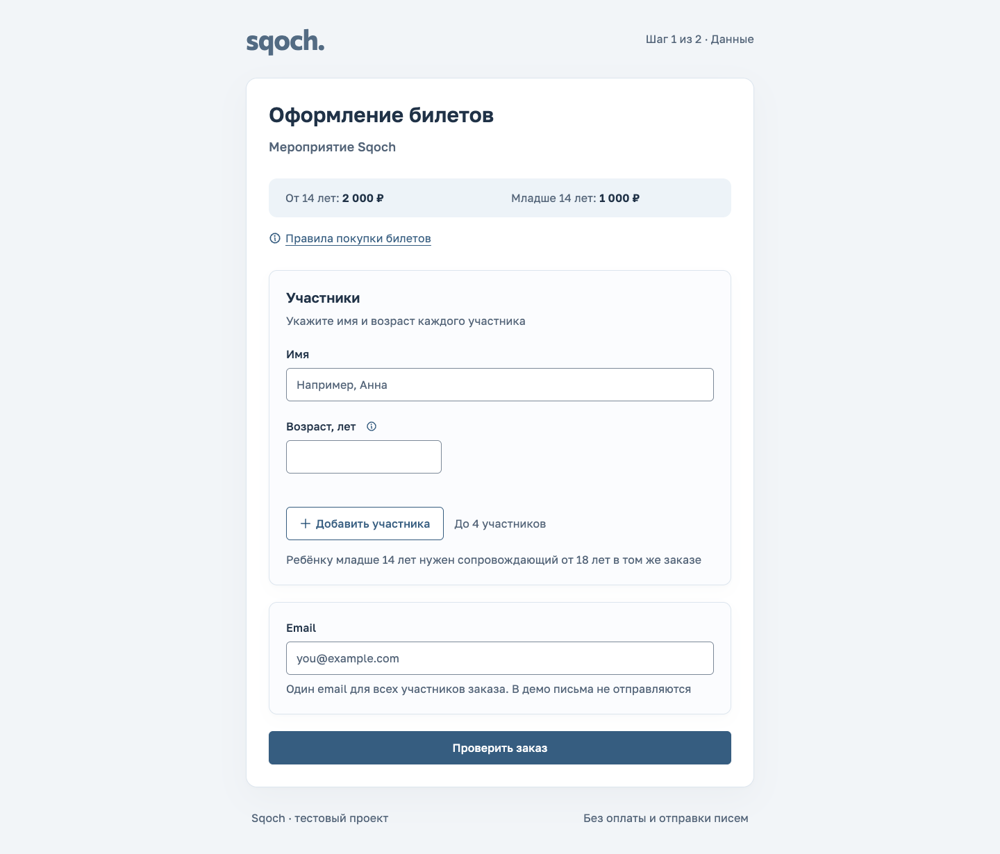

# Sqoch

Локальное приложение на React + FastAPI: оформление билетов и отдельный
кабинет организатора для переноса мероприятий и уведомления покупателей.
Кабинет использует SQLite, DeepSeek и SMTP в локальный Mailpit. Письма
просматриваются в Mailpit; внешняя доставка, оплата, авторизация и публичное
развёртывание в объём не входят.

Требования и технические решения обеих волн собраны в
[карте документации](docs/README.md). Текущие статусы срезов находятся
в [плане](docs/work-plan.md), результаты проверок и их пределы
в [приёмке](docs/acceptance.md).

[Перенос мероприятия, 1 минута 28 секунд](docs/demo/event-transfer.mp4) ·
[Оформление билетов, 58 секунд](docs/demo/checkout.mp4) ·
[Сценарий видео](docs/demo/README.md) · [Результаты проверок](docs/acceptance.md)

Обе волны используют выбранный третий минеральный kit с Golos Text и
Phosphor Bold. [Сравнение с макетом и проверка UI](docs/history/design/design-qa-sqoch-33-20261027.md).
Видео переноса показывает текущий интерфейс и настоящие DeepSeek/Mailpit.
Историческое видео оформления сохраняет прежний интерфейс первого этапа.



## Локальное демо с чистого clone

Последовательность ниже запускает оба потока: booking, кабинет организатора,
настоящую DeepSeek и SMTP в локальный Mailpit. Команды выполняются из корня
проекта в терминале macOS/Linux; на Windows используйте WSL2.

### 1. Подготовьте инструменты

Установите **Git**, **Node.js 26.12.1**, **pnpm 12.15.0**, **uv 0.13.5**
и **Docker с Compose v2**, поддерживающим `up --wait`. Запустите Docker Desktop
или Docker daemon. Node закреплён в `.node-version`, pnpm в `package.json`,
Python **3.15.1** в `backend/.python-version`; uv загрузит Python при установке.
Нужен доступ к публичным реестрам для зависимостей и образа Mailpit, а для AI
к `https://api.deepseek.com` с действующим ключом и доступом к модели
`deepseek-flash`. Ключ в репозиторий не входит.

Проверьте доступность инструментов в том же терминале:

```sh
git --version
node --version
pnpm --version
uv --version
docker compose version
docker info
```

**Agent Platform, RTK, SSH-ключи и приватные пакеты не нужны.** SQLite использует
стандартный Python `sqlite3`; отдельный сервер БД не нужен. Оставьте свободными
порты **5173** (web), **8000** (API), **1025** (SMTP) и **8025** (Mailpit UI).

### 2. Получите исходники и установите зависимости

```sh
git clone https://github.com/pytkin/sqoch-test.git
cd sqoch-test
pnpm run setup
```

Для распакованного исходного кода начните с перехода в его корень и той же
команды `pnpm run setup`. Она устанавливает три дерева зависимостей
в frozen/locked-режиме: приложение, генератор типов и Python backend.
Повторный запуск не обновляет lockfiles. `pnpm setup` является другой,
встроенной командой менеджера пакетов.

### 3. Настройте локальное окружение

Только при первом запуске, когда `.env` ещё нет:

```sh
cp .env.example .env
```

Откройте `.env` в редакторе и заполните `DEEPSEEK_API_KEY` своим ключом.
Остальные значения из примера оставьте для стандартного запуска:

| Переменная            | Значение по умолчанию   | Назначение                                        |
| --------------------- | ----------------------- | ------------------------------------------------- |
| `DEEPSEEK_API_KEY`    | пустое                  | Ключ только для AI-действий backend               |
| `LLM_PROVIDER`        | `deepseek`              | Единственный поддерживаемый провайдер             |
| `DEEPSEEK_MODEL`      | `deepseek-flash`        | Модель для подготовки и переформулировки письма   |
| `SQOCH_DATABASE_PATH` | `data/sqoch.sqlite3`    | SQLite; относительный путь считается от корня     |
| `SQOCH_SMTP_HOST`     | `127.0.0.1`             | Разрешён только этот буквальный loopback-адрес    |
| `SQOCH_SMTP_PORT`     | `1025`                  | SMTP опубликованного контейнера Mailpit           |
| `SQOCH_MAILPIT_URL`   | `http://127.0.0.1:8025` | Локальный HTTP API Mailpit для сверки отправлений |

`.env` игнорируется Git. Команды `dev`, `worker`, `db:init`, `demo:load`
и `demo:reset` загружают его через `scripts/backend.mjs` только в uv/backend.
Ключу не нужен префикс `VITE_`. После изменения `.env` перезапустите `dev`.
Используйте один путь SQLite для API, worker и команд БД; проверьте, что ранее
экспортированные переменные терминала не направляют их в другую БД.

Для демо **без LLM** оставьте ключ пустым, сохранив `LLM_PROVIDER=deepseek`.
Ручной ввод, сохранение, preview, подтверждение и SMTP работают без ключа;
кнопки AI требуют настроенной DeepSeek. Для одного booking можно пропустить
`.env`, Docker и загрузку демоданных: после установки достаточно `pnpm dev`.

### 4. Запустите Mailpit и загрузите демоданные

```sh
docker compose -p sqoch-stage2-dev up -d --wait
docker compose -p sqoch-stage2-dev ps
pnpm db:init
pnpm demo:load
```

Дождитесь успешного завершения `up --wait` и состояния `healthy` у Mailpit.
Команды БД должны напечатать `db:init: complete` и `demo:load: complete`.
Чистая загрузка содержит два мероприятия и 20 синтетических покупок:
«Керамика», 10 ноября 2026 года, 19:00, и «Живопись», 12 ноября 2026 года,
18:00 по Москве. Выборка активных покупателей даст соответственно **8**
и **5** уникальных email. Покупки независимы от booking и не создаются им.

`db:init` создаёт/обновляет только схему. `demo:load` явно обновляет записи
по стабильным ID, сохраняя рассылки, но может вернуть дату события из fixtures.
Для продолжения прежней работы не запускайте `demo:load` повторно.

### 5. Запустите приложение и проверьте готовность

```sh
pnpm dev
```

Оставьте этот терминал открытым. `dev` проверяет схему SQLite, затем запускает
API, Vite и отдельный worker. Дождитесь адреса Vite `http://127.0.0.1:5173`,
сообщения Uvicorn `Application startup complete` и **`worker: ready`**.
API/web имеют reload; worker продолжает отправку при закрытом браузере.
Один worker обслуживает один файл БД; второй вручную запускать не нужно.

Откройте [билеты](http://127.0.0.1:5173/#/booking),
[мероприятия](http://127.0.0.1:5173/#/organizer) и
[Mailpit](http://127.0.0.1:8025). Vite проксирует `/api` в Uvicorn на 8000.
В другом терминале можно проверить HTTP без изменения данных:

```sh
curl --fail --silent --show-error http://127.0.0.1:5173/api/event
curl --fail --silent --show-error http://127.0.0.1:5173/api/organizer/events
```

Оба запроса должны завершиться успешно и вернуть JSON; второй содержит
`items` с `ceramics` и `painting`. Это проверяет web/API, но не вызов DeepSeek
и не SMTP. Их проверяет полный путь ниже. Не меняйте часы компьютера:
приложение проверяет будущее начало и подстановку года по `Europe/Moscow`.

## Кабинет организатора

1. Откройте мероприятие и нажмите «Перенести мероприятие». Помощник также
   доступен из общего обзора: в этом случае укажите название мероприятия
   в запросе. На первом экране видны запрос и известный контекст события;
   отправка запроса выполняется кнопкой «Подготовить перенос».
2. Опишите новую дату и время по Москве, например «Переносим Керамику на
   20 ноября, 19:00». Если мероприятие проходит в текущем московском году
   и указанная дата ещё впереди, год подставится автоматически. При прошедшей
   дате либо другом годе мероприятия помощник уточнит год, сохранив день
   и время. Явный год имеет приоритет; недостающие или неоднозначные сведения
   требуют адресного ответа. Подготовленный результат заполняется автоматически.
   Этот пример без года рассчитан на запуск до 20 ноября 2026 года.
   Позднее выберите действительно будущую дату и явно напишите её полный год:
   fixtures сохраняют исходный 2026 год и автоматически не сдвигаются.
3. Чтобы обойтись без помощника, нажмите «Заполнить вручную»: поля даты,
   времени и письма раскроются под запросом. Сохранение ручной подготовки
   не вызывает LLM. Укажите будущую дату, время, тему и текст, нажмите
   «Сохранить подготовку». Посещение страницы и раскрытие режима ничего не создают.
4. В готовом результате проверьте мероприятие, прежнее и новое начало,
   тему и текст. «Изменить» раскрывает нужные поля. Переформулировка письма
   запускается отдельным действием. Отметьте «Текст соответствует мероприятию
   и новой дате», затем нажмите «Проверить перенос».
5. Серверный предпросмотр показывает точные подтверждаемые данные и полный
   список получателей: восемь email для «Керамики», пять для «Живописи».
   До подтверждения дата события прежняя и заданий отправки нет.
6. Отдельное действие «Подтвердить перенос и уведомить покупателей» одной
   транзакцией меняет дату мероприятия и сохраняет задания. Только после
   него worker начинает отправку в локальный Mailpit.
7. Проверьте прогресс и результат каждого адреса, вернитесь к мероприятию
   и его истории. Закрытие страницы не останавливает worker; возврат по той же
   ссылке восстанавливает сохранённое состояние. В Mailpit проверьте
   получателя, тему и текст принятого письма. В чистом успешном прогоне для
   «Керамики» ожидаются 8/8 и восемь писем этой рассылки без повторов адреса.
   Старая почта Mailpit остаётся: общее количество писем не обязано быть восемь.

Содержательный запрос сохраняется перед вызовом помощника, ручные данные
сохраняются явной кнопкой. Несохранённый ввод защищён предупреждением об уходе,
но refresh не восстанавливает ещё не сохранённые символы. GET и reload не
запускают LLM повторно и не пересчитывают сохранённый год. Изменение исходных
данных снимает отметку проверки и требует нового предпросмотра и подтверждения.

При временном SMTP-отказе worker повторяет отправку с задержками 5/15/60/120
секунд. «Продолжить отправку» ускоряет разрешённый повтор; общий лимит — пять
попыток, включая ручные и после restart. Успехи не отправляются повторно.
«Требует проверки» означает неизвестный исход: используйте сверку Mailpit.
Только точное совпадение подтверждает успех; отсутствие письма не разрешает
автоматическую переотправку. Не удаляйте письма, пока нужна такая сверка.
«Отправлено» подтверждает локальный приём SMTP, а не внешнюю доставку.

## Остановка, повторный запуск и сброс

Ctrl+C в терминале `pnpm dev` завершает API/web/worker. Затем остановите Mailpit:

```sh
docker compose -p sqoch-stage2-dev down
```

SQLite сохраняется в `data/sqoch.sqlite3` либо по `SQOCH_DATABASE_PATH`.
Обычные restart/down сохраняют письма в именованном volume
`sqoch-stage2-dev_mailpit-data`. Для продолжения с теми же данными:

```sh
docker compose -p sqoch-stage2-dev up -d --wait
pnpm dev
```

Снова дождитесь `worker: ready`. Сохранённые подготовки, подтверждённые переносы,
задания и счётчики восстанавливаются. Прерванный SMTP может иметь неизвестный
исход: worker сверяет его с Mailpit, а недоказанный результат остаётся
«Требует проверки». API/worker не должны работать во время сброса БД.

Для нового чистого сценария **только после остановки `dev`**:

```sh
pnpm demo:reset --yes
pnpm dev
```

`demo:reset --yes` удаляет все сохранённые подготовки, рассылки и результаты
в выбранной SQLite и заново загружает fixtures. Mailpit он не очищает.
`docker compose -p sqoch-stage2-dev down -v` отдельно удаляет volume с письмами;
после этого нужна новая команда `up -d --wait`. Делайте это только если прежние
письма больше не нужны для сверки неизвестных результатов. Чужая, повреждённая
или неизвестная версия БД при обычном старте автоматически не перезаписывается.

Если меняете порты Mailpit, задайте в `.env` согласованную пару
`MAILPIT_SMTP_PORT` / `SQOCH_SMTP_PORT` и `MAILPIT_HTTP_PORT` /
`SQOCH_MAILPIT_URL`, затем пересоздайте контейнер и перезапустите `dev`.
Хост SMTP и HTTP остаётся `127.0.0.1`. Для стандартного демо это не требуется.

## Проверка настоящего SMTP и отказов

```sh
pnpm test:mailpit
pnpm demo:failure
```

Обе команды используют отдельный Compose project `sqoch-mailpit-tests`, порты
11025/18025 и временные SQLite; рабочая БД/почта не очищаются. `test:mailpit`
проверяет настоящий SMTP, отказ 451, аварийный restart, сверку и сохранность
писем. `demo:failure` воспроизводит 3 успеха → отказ → остановку → продолжение
до 8 уникальных писем и печатает контрольные результаты. Это технический
прогон без видеозаписи. Chaos сбрасывается, контейнер останавливается после
обычного завершения; тестовые письма остаются в отдельном volume.

## Оформление билетов

Сценарий первого этапа:

1. Добавьте сопровождающего 18 лет и ребёнка 13 лет: сумма — 3 000 ₽.
2. На проверке измените возраст ребёнка на 14: новый расчёт — 4 000 ₽.
3. Выберите «Нет мест» в демогруппе и подтвердите: будет отказ с сохранёнными
   данными. Выберите «Успех» и повторите подтверждение вручную.
4. Проверьте пустые поля, ребёнка без сопровождающего, удаление и возврат
   участника, лимит 4, адресное редактирование и новый заказ.

Участник 14–17 лет может идти отдельно, но не сопровождает ребёнка младше 14.
Одного сопровождающего от 18 лет достаточно для нескольких детей в заказе.
Имя и возраст обязательны, общий email один. Подробности — в [брифе](docs/brief.md).

Заказы и черновик booking живут в памяти страницы; refresh очищает их.
Этот поток не сохраняет покупки, не меняет реальные остатки и не отправляет
письма. Успех оформления — демонстрационный.
Таймаут ответа — 15 секунд. При потере ответа confirm результат неизвестен;
автоматического повтора нет.
[Ошибки формы на 360 px](docs/preview/ui-kit-3-20261027/03-booking-errors-mobile.png).

## Если запуск не удался

| Симптом                                                   | Что проверить                                                                                                                                                                                                 |
| --------------------------------------------------------- | ------------------------------------------------------------------------------------------------------------------------------------------------------------------------------------------------------------- |
| `node`, `pnpm` или `uv` не найдены; установка не проходит | Версии и PATH из шага 1, доступ к публичным реестрам. Запускайте `pnpm run setup` из корня; не удаляйте lockfiles ради повторной установки.                                                                   |
| Docker не отвечает или `up --wait` завершился ошибкой     | Запущен ли Docker daemon; результат `docker compose -p sqoch-stage2-dev ps` и `docker compose -p sqoch-stage2-dev logs mailpit`.                                                                              |
| `address already in use` / порт занят                     | Остановите предыдущий экземпляр проекта либо процесс на соответствующем порту. Vite использует строго 5173, API 8000. Не запускайте два `pnpm dev` одновременно.                                              |
| Кабинет пустой                                            | Выполнен ли `pnpm demo:load`; совпадает ли `SQOCH_DATABASE_PATH` у команд БД, API и worker. Простое `db:init` мероприятия не добавляет.                                                                       |
| AI недоступен                                             | Ключ, доступ к `deepseek-flash` и HTTPS до DeepSeek; `.env` лежит в корне. После изменения настроек нужен restart `dev`. До исправления доступен ручной режим.                                                |
| Помощник спрашивает год или дата не принимается           | Будущее начало по Москве и полный год. Фикстуры датированы 2026 годом; следующий год автоматически не выбирается.                                                                                             |
| Рассылка не движется                                      | Есть ли `worker: ready`, здоров ли Mailpit, совпадают ли SMTP-порты и путь SQLite. При «Требует проверки» используйте «Проверить результат отправки»; новый перенос не является способом безопасного повтора. |
| Worker завершился из-за блокировки / ошибка миграции      | Не работает ли другой worker с этой SQLite; остановлены ли API/worker перед reset. Сохраните существующую БД и выясните причину, вместо её удаления.                                                          |
| E2E не стартует                                           | Остановите `pnpm dev` перед `verify`, освободите 8000 и установите Chromium командой ниже. На Linux Playwright может дополнительно потребовать системные библиотеки браузера.                                 |

## Проверки

Предварительные тесты второго этапа после red/green перенесены в обычный
backend suite; отдельные pending-команды удалены. Xfail/skip не используются.
Точный контракт, порядок TDD и границы — в [спецификации](docs/notifications-contract.md).

```sh
pnpm lint
pnpm typecheck
pnpm format:check
pnpm test
pnpm contracts:check
pnpm build
pnpm docs:check
```

Полный набор включает настоящий браузер. Сначала остановите `pnpm dev`:

```sh
pnpm exec playwright install chromium
pnpm verify
```

Playwright сам запускает API со свежим `dist/`, отдельной SQLite и worker;
порт 8000 должен быть свободен. В `e2e/organizer.spec.ts` 11 сценариев,
каждый выполняется на desktop и mobile. Семь используют настоящие
API/SQLite/worker с управляемыми AI/SMTP-адаптерами: полный перенос, потерю
ответа подтверждения, устаревший preview, клавиатуру/reflow, текущий год,
уточнение года и защиту несохранённого ввода. Ещё четыре подменяют organizer
HTTP API для проверки ссылок, доступности восстановления, неизвестного
результата отправки и длинных значений/HTML как обычного текста. Настоящие
DeepSeek/Mailpit проверяются отдельно.
Обычные тесты, включая `verify`, ключа и Docker не требуют.
`test:frontend`, `test:backend`, `test:tooling`, `test:e2e` запускают отдельные
части. Известное deprecation-предупреждение Starlette/HTTPX TestClient описано
в [приёмке](docs/acceptance.md); предупреждения не скрываются.

Отдельная проверка чувствительности тестов к 42 смысловым изменениям,
включая все 33 прежних случая и девять проверок нового сценария переноса:

```sh
pnpm test:mutation
```

Она использует изолированные копии и существующие Vitest/pytest, не требует
новых зависимостей и не входит в обычный `verify`. Результаты и логи находятся
в `.cache/mutation/current/`; метод и границы описаны в
[отчёте рефакторинга](docs/history/refactoring-20261027.md), дополнения нового сценария в
[журнале SQOCH-39–44](docs/event-transfer-implementation.md).
Это конечный набор мутаций, а не глобальная оценка покрытия всего проекта.

## Где читать код

```text
src/features/booking/        оформление билетов без сохранения покупок
src/features/organizer/      кабинет, API-адаптер и компонентные тесты
src/api/abortable.ts         общий deadline запроса и отмена
src/api/generated/          общий Pydantic/OpenAPI-контракт в TypeScript
src/styles.css              принятая дизайн-система; fonts.css — локальные шрифты
backend/sqoch_api/           приложение и booking API
backend/sqoch_api/notifications/  SQLite, AI, SMTP, worker и organizer API
backend/migrations/         SQL-миграции
backend/tests/              серверные правила, контракты и процессные тесты
backend/integration/        отдельные настоящие Mailpit-проверки и E2E-адаптеры
fixtures/demo.json          отдельные тестовые события и покупки
e2e/                        настоящая UI/API/SQLite-связка и управляемые отказы
tools/openapi/              Hey API / TypeScript 6 для генерации типов
scripts/                    запуск, генерация и локальные проверки
docs/                       требования, архитектура, дизайн, приёмка и демо
```

Pydantic владеет контрактом. `pnpm contracts:generate` обновляет только
объявления типов в `src/api/generated`; `contracts:check`
сравнивает временную генерацию с сохранёнными файлами. Приложение использует
TypeScript 7, генератор — изолированный TypeScript 6 со своим lockfile.
Причина исключения и API — в [технической спецификации](docs/technical-specification.md).

## Локальный просмотр готовой сборки

После шагов установки, настройки `.env` и загрузки демоданных остановите
`pnpm dev`. Mailpit для отправки должен оставаться запущенным.

```sh
pnpm build
pnpm db:init
node scripts/backend.mjs uvicorn sqoch_api.app:app --host 127.0.0.1 --port 8000
```

Откройте [http://127.0.0.1:8000](http://127.0.0.1:8000).
В другом терминале из того же корня запустите `pnpm worker` и дождитесь
`worker: ready`. Остановка API не завершает отдельно запущенный worker:
остановите оба терминала через Ctrl+C. Это локальная раздача
сборки; deployment и CI в тест не входят.

## Версии и материалы

Версии зависимостей закреплены точно. `engines.node >=24.15.0` и
`engines.pnpm >=11` задают нижние границы, а не автоматически проверенную
совместимость всех будущих выпусков. Другой Node можно выбрать в PATH,
другой pnpm — его бинарником с `--pm-on-fail=ignore` (Corepack может выбрать
менеджер раньше CLI). Python: `uv sync --project backend --locked --python VERSION`.
Фактическая проверенная среда указана в [приёмке](docs/acceptance.md).

[Бриф](docs/brief.md) · [Архитектура и API](docs/technical-specification.md) ·
[Дизайн-система](docs/design-system.md) · [План и TDD](docs/work-plan.md) · [AGENTS](AGENTS.md)

Исходные PDF не переиздаются; требования изложены в брифе. Сторонние assets
распространяются со своими лицензиями: [Golos Text OFL](public/fonts/golos-text/OFL.txt),
[Phosphor Bold MIT](public/icons/phosphor-bold/LICENSE),
[Commissioner OFL](public/fonts/commissioner/OFL.txt) для исходного логотипа.
Сохранённые прежние иконки имеют [Lucide ISC/MIT](docs/design/archive/lucide/LICENSE).
Лицензия исходного кода проекта отдельно не назначена. Видео не отправлялось HR.
Репозиторий исходного кода: [pytkin/sqoch-test](https://github.com/pytkin/sqoch-test).
История публикации первого этапа зафиксирована в плане и приёмке.
