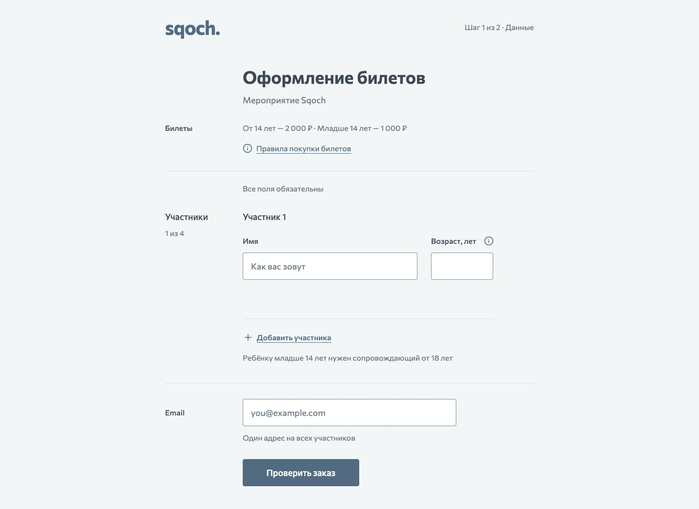

# Sqoch

Демонстрация оформления билетов на мероприятие: участники, серверный расчёт,
редактирование, подтверждение и отказ при отсутствии мест. React + FastAPI.

[Видео для просмотра, 44 секунды](docs/demo/checkout.mp4) ·
[Сценарий видео](docs/demo/README.md) · [Результаты проверок](docs/acceptance.md)



## Запуск

Нужны **Node.js 26.12.1**, **pnpm 12.15.0**, **uv 0.13.5** в PATH и доступ
к публичным реестрам для первой установки. Python 3.15.1 uv получит автоматически.

Из корня обычного clone или распакованного исходного кода:

```sh
pnpm run setup
pnpm dev
```

Откройте [http://127.0.0.1:5173](http://127.0.0.1:5173).
Vite проксирует `/api` в Uvicorn на 8000. Оба процесса имеют reload;
Ctrl+C останавливает их. Порты 5173 и 8000 должны быть свободны.

**Agent Platform, RTK, SSH-ключи, Docker и `.env` не требуются.**
`pnpm run setup` устанавливает три дерева зависимостей в frozen/locked-режиме:
приложение, генератор типов и Python backend. Повторный запуск не обновляет
lockfiles. Используйте именно `pnpm run setup`: `pnpm setup` — другая,
встроенная команда менеджера пакетов. Для разработки без генерации достаточно
`pnpm install --frozen-lockfile` и `pnpm dev`.

## Что проверить в приложении

1. Добавьте сопровождающего 18 лет и ребёнка 13 лет: сумма — 3 000 ₽.
2. На проверке измените возраст ребёнка на 14: новый расчёт — 4 000 ₽.
3. Выберите «Нет мест» в демогруппе и подтвердите: будет отказ с сохранёнными
   данными. Выберите «Успех» и повторите подтверждение вручную.
4. Проверьте пустые поля, ребёнка без сопровождающего, удаление и возврат
   участника, лимит 4, адресное редактирование и новый заказ.

Участник 14–17 лет может идти отдельно, но не сопровождает ребёнка младше 14.
Одного сопровождающего от 18 лет достаточно для нескольких детей в заказе.
Имя и возраст обязательны, общий email один. Подробности — в [брифе](docs/brief.md).

Заказы и черновик живут в памяти страницы; refresh очищает их. Нет БД,
реальных остатков, оплаты, писем и авторизации. Успех — демонстрационный.
Таймаут ответа — 15 секунд. При потере ответа confirm результат неизвестен;
автоматического повтора нет. [Мобильный экран 360 px](docs/preview/mobile.png).

## Проверки

```sh
pnpm lint
pnpm typecheck
pnpm format:check
pnpm test
pnpm contracts:check
pnpm build
pnpm docs:check
```

Полный набор включает настоящий браузер:

```sh
pnpm exec playwright install chromium
pnpm verify
```

Playwright сам запускает API со свежим `dist/`; порт 8000 должен быть свободен.
`test:frontend`, `test:backend`, `test:tooling`, `test:e2e` запускают отдельные
части. Известное deprecation-предупреждение Starlette/HTTPX TestClient описано
в [приёмке](docs/acceptance.md); предупреждения не скрываются.

## Где читать код

```text
src/features/booking/   controller, форма, сводка, API-адаптер, компоненты
src/styles.css         принятая дизайн-система; fonts.css — локальные шрифты
backend/sqoch_api/      Pydantic-схемы, правила заказа, три HTTP endpoint
backend/tests/         серверные правила и контракт
src/*.test.tsx         компонентные сценарии; api.test.ts — транспорт
e2e/                  настоящая UI/API-связка и управляемые отказы
tools/openapi/        отдельный Hey API / TypeScript 6 для генерации типов
scripts/              генерация и локальные проверки проекта
docs/                 требования, архитектура, дизайн, приёмка и демо
```

Pydantic владеет контрактом. `pnpm contracts:generate` обновляет только
объявления типов в `src/features/booking/generated`; `contracts:check`
сравнивает временную генерацию с сохранёнными файлами. Приложение использует
TypeScript 7, генератор — изолированный TypeScript 6 со своим lockfile.
Причина исключения и API — в [технической спецификации](docs/technical-specification.md).

## Готовая сборка одним процессом

```sh
pnpm build
uv run --project backend --locked uvicorn sqoch_api.app:app --host 127.0.0.1 --port 8000
```

Откройте [http://127.0.0.1:8000](http://127.0.0.1:8000).
Это локальная раздача сборки; deployment и CI в тест не входят.

## Версии и материалы

Версии зависимостей закреплены точно. `engines.node >=24.15.0` и
`engines.pnpm >=11` задают нижние границы, а не автоматически проверенную
совместимость всех будущих выпусков. Другой Node можно выбрать в PATH,
другой pnpm — его бинарником с `--pm-on-fail=ignore` (Corepack может выбрать
менеджер раньше CLI). Python: `uv sync --project backend --locked --python VERSION`.
Фактическая проверенная среда указана в [приёмке](docs/acceptance.md).

[Бриф](docs/brief.md) · [Архитектура и API](docs/technical-specification.md) ·
[Дизайн-система](docs/design-system.md) · [План и TDD](docs/work-plan.md) · [AGENTS](AGENTS.md)

Исходные PDF не переиздаются; требования изложены в брифе. Сторонние assets
распространяются со своими лицензиями: [Commissioner OFL](public/fonts/commissioner/OFL.txt),
[Lucide ISC/MIT](public/icons/lucide/LICENSE). Лицензия исходного кода проекта
отдельно не назначена. Видео не отправлялось HR; репозиторий не публиковался.
