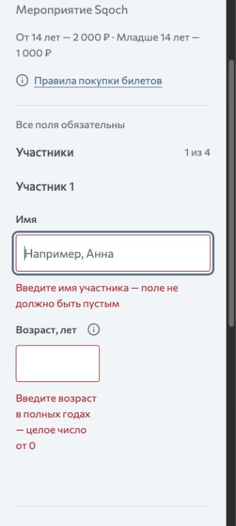
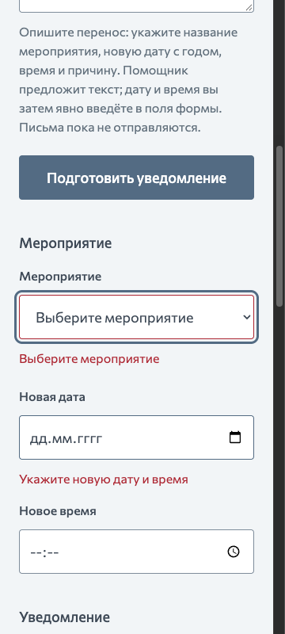
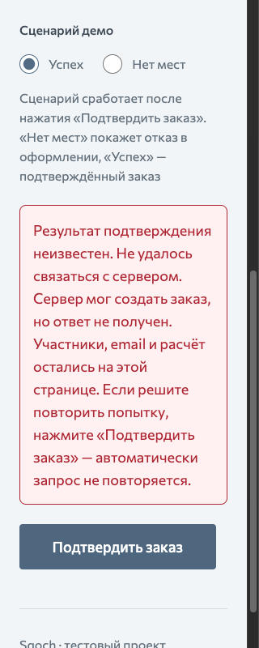

# Ошибки и визуальная иерархия обеих волн

Последующий [пересмотр всей системы](../design/design-reset-audit-20261027.md)
и [новые kit](../../design/ui-kits-20261027/README.md) заменяют ранние визуальные
предложения этого документа. Наблюдения об ошибках и сценариях сохраняют
свою область и исходные свидетельства.

Дата проверки: 27 октября 2026 года. Область — оформление билетов и кабинет
организатора. Проверка выполнена в работающем локальном приложении, с новыми
снимками экранов, измерениями DOM и чтением обработчиков ошибок. Это дополнение
к [аудиту кабинета](organizer-ux-20261027.md), а не замена его результатов.

## Вывод

В проверенных состояниях текст не обрезается, не накладывается на элементы и не
создаёт горизонтальную прокрутку. Ошибки полей имеют размер 16/24 px, общие
уведомления — 18/28 px. Формулировки объясняют действие и восстановление.
Главные проблемы — ширина сообщения возраста, неполное выделение связанных
полей даты/времени, исчезновение ошибок других полей и недостаточная структура
развёрнутых уведомлений. Уменьшать шрифт или удалять важные объяснения не нужно.

На момент этого аудита новая визуальная система ещё не была принята.
Результаты Ideate были растровыми концепциями для выбора и не доказывали
адаптивность, доступность или реализацию. Последующее решение пользователя
о третьем минеральном kit зафиксировано в [дизайн-системе](../../design-system.md),
результаты визуального среза SQOCH-33 в [Design QA](../design/design-qa-sqoch-33-20261027.md).

## Проверенные шаги

| №   | Сценарий                                                                 | Состояние                                                                  | Свежие свидетельства                                                                                                                                                  |
| --- | ------------------------------------------------------------------------ | -------------------------------------------------------------------------- | --------------------------------------------------------------------------------------------------------------------------------------------------------------------- |
| 1   | Билеты: пустые имя, возраст, email                                       | Читаемо; ошибка возраста слишком узкая                                     | [desktop 1440](../../preview/errors-20261027/23-booking-fields-1440.png), [360](../../preview/errors-20261027/02-booking-fields-mobile.jpg)                           |
| 2   | Билеты: ребёнок без сопровождающего                                      | Сообщение на ширину группы, понятное исправление                           | [360](../../preview/errors-20261027/03-booking-composition-mobile.jpg)                                                                                                |
| 3   | Билеты: отказ «Нет мест»                                                 | Смысл и данные сохранены; сплошной абзац трудно сканировать                | [360](../../preview/errors-20261027/11-booking-soldout-360.png)                                                                                                       |
| 4   | Билеты: неизвестный результат подтверждения                              | Не обещает, что заказ не создан; требуется отдельная визуальная семантика  | [360](../../preview/errors-20261027/12-booking-unknown-360.png), [320](../../preview/errors-20261027/19-booking-unknown-320.png)                                      |
| 5   | Билеты: ошибка расчёта и загрузки мероприятия                            | Текст и повтор доступны, данные формы при сбое расчёта остаются            | [расчёт 320](../../preview/errors-20261027/20-booking-quote-320.png), [загрузка 320](../../preview/errors-20261027/24-booking-load-320.png)                           |
| 6   | Рассылки: пустые мероприятие, дата/время, тема, письмо, отметка проверки | Ошибки рядом с полями; пустое время не отмечено                            | [desktop 1440](../../preview/errors-20261027/25-organizer-fields-1440.png), [360](../../preview/errors-20261027/08-organizer-fields-360.png)                          |
| 7   | Рассылки: пустые запрос помощнику и просьба изменить текст               | Фокус корректный; полезная инструкция заменяется ошибкой                   | [запрос desktop](../../preview/errors-20261027/06-organizer-prompt-desktop.jpg), [редактирование 360](../../preview/errors-20261027/13-organizer-instruction-360.png) |
| 8   | Рассылки: недоступный запрос помощника                                   | Ошибка находится под запущенным действием, текст читается                  | [360](../../preview/errors-20261027/09-organizer-ai-network-360.png)                                                                                                  |
| 9   | Рассылки: серверная валидация 422                                        | Сопоставлена с полем и фокусом; ошибка даты/времени отмечает только дату   | [360](../../preview/errors-20261027/16-organizer-server422-360.png)                                                                                                   |
| 10  | Рассылки: конфликт версии 409                                            | Сообщение и «Обновить сведения» находятся вместе; восстановление проверено | [360](../../preview/errors-20261027/17-organizer-conflict-360.png), [320](../../preview/errors-20261027/18-organizer-conflict-320.png)                                |
| 11  | Рассылки: ошибка загрузки кабинета                                       | Повтор доступен и восстанавливает форму                                    | [320](../../preview/errors-20261027/21-organizer-load-320.png)                                                                                                        |
| 12  | Рассылки: неизвестная доставка и окончательный отказ по адресу           | Причины читаются; предупреждение и отказ различаются цветом и текстом      | [неизвестно 360](../../preview/errors-20261027/14-organizer-unknown-360.png), [отказ 360](../../preview/errors-20261027/15-organizer-failed-360.png)                  |
| 13  | Рассылки: исправление одного поля после отправки пустой формы            | Подтверждён дефект: остальные ошибки исчезают                              | [после выбора мероприятия](../../preview/errors-20261027/26-organizer-errors-cleared-1440.png)                                                                        |

Сетевые сбои вызваны блокировкой конкретных локальных запросов во вкладке;
422 и 409 — подстановкой ответов через DevTools только для тестового черновика.
Блокировки и перехваты сняты после проверки. Отказы по получателям прочитаны
из текущей локальной рассылки; новых отправок этот аудит не запускал.
Успешный расчёт заказа и восстановление обеих загрузок проверены через UI.

## Находки и проверяемые решения

### E1. Ошибка возраста наследует ширину короткого поля — P2

**Наблюдение.** Сообщение «Введите возраст в полных годах — целое число от 0»
занимает 128×96 px, четыре строки, и на desktop, и при ширине 360 px.
Другие ошибки используют 297–440 px. Под коротким полем образуется высокая
узкая колонка и большой пустой промежуток до следующего действия.

**Решение.** Оставить коротким сам input возраста. Отдельный блок его сообщения
расположить на ширину группы участника: на desktop — ниже строки полей,
на mobile — на всю доступную строку. Сохранить точную привязку через
`aria-describedby`, сообщение и размер 16/24 px. Ошибки разных участников
не объединять в общий неадресный текст.

**Приёмка.** На 320/360/720/1440 px сообщение не ограничено шириной 128 px;
нет обрезания и горизонтального overflow. При ошибках обоих полей понятно,
к какому input относится каждая. Проверить также четырёх участников.

### E2. Связанная ошибка даты/времени отмечает только дату — P2

**Наблюдение.** При пустой форме показано «Укажите новую дату и время».
`organizer-date` имеет `aria-invalid=true`, а пустое `organizer-time` —
`aria-invalid=false`; его описание не содержит ошибки. Серверный
`proposed_start` также сопоставляется только с датой.

**Решение.** Для отсутствующего значения выделять соответствующее поле;
если отсутствуют оба — оба. Ошибку общего момента времени (прошлое,
некорректный `proposed_start`) оформить общей строкой под парой и связать
с обоими input. Сохранить пояснение о московском времени.

**Приёмка.** Пустая пара, только дата, только время, прошлая пара и серверный
422 дают корректные признаки ошибки и описания; фокус попадает в первое
незаполненное или некорректное поле. Исправление даты не скрывает ошибку
пустого времени.

### E3. Исправление одного поля скрывает все ошибки формы — P2

**Наблюдение.** После проверки пустой рассылки выбор мероприятия убирает
ошибки даты, темы, письма и проверки текста. Эти значения остаются пустыми.
Чтение `edit()` подтверждает общее `setFields({})`.

**Решение.** После первой попытки проверки пересчитывать затронутое поле и
его зависимости. Ошибки других невалидных полей сохранять до исправления.
Изменение мероприятия по-прежнему сбрасывает подтверждение текста, но не
маскирует остальные пропуски.

**Приёмка.** Пустая форма → проверка → выбор мероприятия: ошибка мероприятия
исчезает, ошибки даты/времени, темы и тела остаются. Проверить каждый input,
checkbox, помощника и серверные ошибки. До первой проверки не показывать
преждевременные ошибки необязательного незаполненного черновика.

### E4. Развёрнутые уведомления оформлены сплошным абзацем — P2

**Наблюдение.** При 320 px уведомление о неизвестном результате занимает
257×370 px. Обрезания нет, но состояние, причина, сохранность данных и
решение о повторе визуально равноценны. В билетах неизвестный результат
оформлен красным так же, как доказанный отказ; в рассылках он уже отличается.

**Решение.** Общий компонент уведомления: короткий смысловой заголовок,
описание, отдельный абзац о данных и восстановлении, действие рядом.
Неизвестный результат — предупреждение с явным текстом о возможном создании
заказа; окончательный отказ — ошибка. Цвет дополнить словами и понятным
значком. Сохранить все существенные сведения и обычную пунктуацию.

Пример структуры с тем же смыслом:

> **Результат подтверждения неизвестен**
>
> Не удалось связаться с сервером. Он мог создать заказ, но ответ не получен.
>
> Участники, email и расчёт остались на этой странице.
>
> Если решите повторить попытку, нажмите «Подтвердить заказ».
> Автоматически запрос не повторяется.

**Приёмка.** Все разновидности загрузки, расчёта, подтверждения, сохранения,
помощника и конфликта проверены на 320/360/1440 px. Сохраняются фокус,
объявление сообщения и доступная кнопка восстановления. Нельзя сообщать,
что заказ не создан, при неизвестном результате или автоматически повторять
такой запрос. Растровое превью не подтверждает эти свойства.

### E5. Ошибка заменяет содержательную подсказку — P2

**Наблюдение.** Пустой запрос помощнику заменяет инструкцию о названии,
годе, времени и причине общим «Введите просьбу длиной от 1 до 4000 символов».
Аналогично заменяются подсказки редактирования письма и общего email заказа.
Именно при исправлении пользователь теряет часть необходимого контекста.

**Решение.** Разделить постоянную помощь и текущую ошибку. Показывать оба
текста, если они содержат разные сведения; у поля перечислять оба ID в
`aria-describedby`. Удалять только буквальное дублирование, не смысл.

**Приёмка.** После ошибки видны и инструкция о содержании запроса, и причина
ошибки. То же для просьбы редактирования и email. Текст не мельче 16 px,
не скрыт в placeholder или tooltip и не обрезан фиксированной высотой.

### E6. Повторяемость статуса и сообщения можно оформить яснее — P3

В конфликте версии кнопка находится внутри сообщения, это удачное решение.
В списке доставок причина также занимает всю строку, а неизвестность
отличается от окончательного отказа. Сохранить это при редизайне.
Для временного отказа использовать роль ожидания/предупреждения, а не цвет
окончательного отказа; рядом оставить время следующей попытки и лимит.
Не превращать каждый адрес в самостоятельную вложенную карточку.

В текущем аудите снимки временного отказа и исчерпания пяти попыток не
пересоздавались: проверена их разметка и существующие frontend-тесты.
Визуальная приёмка этих двух состояний остаётся обязательной при реализации.

## Границы проверки

- Проверены desktop 1440 px, промежуточный desktop 933 px и узкие 360/320 px;
  фактическая ширина считана из DOM. Высота узких экранов — 800 px.
- Снимки 07, 10 и 22 отвергнуты из-за масштабирования/повторения области
  захвата инструментом. Они не являются дефектами приложения и не используются
  в выводах. Дубли 04/05 с неверной подписью ширины также исключены.
- На 320 px в проверенных сообщениях ширина документа — 305 px; на 360 —
  345 px с учётом вертикальной полосы прокрутки. Горизонтального overflow нет.
- `pnpm test:frontend`: 5 файлов, 123 теста пройдены в этом запуске.
  Они не доказывают отсутствие найденных UX-проблем: для E1–E5 нужны новые
  проверки, соответствующие критериям выше.
- Полный backend/E2E pipeline в этом аудите не перезапускался. Live DeepSeek,
  новая SMTP-доставка, скринридер, 200% zoom и forced colors в текущую
  проверку не входили. Цвет и объявление ошибок нельзя полностью оценить
  по одному растру.
- Создан отдельный локальный черновик для аудита. Существующие рассылки и
  продуктовый код аудит не изменяет. Демо и публикация не выполнялись.

## Срезы реализации после выбора направления

1. **Контракт ошибок и TDD.** Добавить содержательные падающие проверки E2/E3/E5
   и отдельных состояний `failed`/`unknown`; затем минимально исправить
   валидацию, жизненный цикл ошибок и связи описаний. Не менять API.
2. **Компоненты и сетка.** Реализовать E1/E4 и выбранные поверхности на общих
   токенах. Сохранить возраст коротким, сообщения широкими, списки компактными,
   тексты информативными. Обновить каноническую дизайн-систему выбранным решением.
3. **Обе волны и приёмка.** Применить компоненты к оформлению билетов, проверке,
   отказу/успеху, списку рассылок, помощнику, форме, предпросмотру и доставкам.
   Визуально проверить положительные и отрицательные состояния, длинные
   значения, четырёх участников, временный отказ, исчерпание лимита, клавиатуру,
   320/360/719/720/768/1440 px, 200% zoom и доступные режимы. Запустить подходящие
   проверки и независимое ревью по правилам проекта до приёмки.

## Визуальное исследование Ideate

Цель — более выразительная иерархия общего UI обеих волн. Сравниваются три
самостоятельные концепции одной и той же формы билетов с ошибками.
Референсы — свежие снимки 23 (билеты), 25 (кабинет), 02 (узкое сообщение
возраста) и 08 (дата/время). Новые возможности, платёж, авторизация и внешняя
доставка не добавляются. Текст — Commissioner; основной 18 px, пояснения
и ошибки не меньше 16 px. Генерация выполняется встроенным Image Gen через
Product Design Ideate. Номер варианта определяется порядком показа изображений
в чате, а не внутренним названием концепции.

Сохранены [три результата и полные запросы](../../design/archive/ideation-20261027/README.md).
Варианты пронумерованы по фактическому показу: [1](../../design/archive/ideation-20261027/images/option-1.png),
[2](../../design/archive/ideation-20261027/images/option-2.png), [3](../../design/archive/ideation-20261027/images/option-3.png).
Пользователь предпочёл третий вариант и запросил более спокойные контраст
и типографику. Подготовлено [уточнение направления](../../design/archive/ideation-20261027/refinement.md);
его принятие ожидается. Продуктовый интерфейс не переработан.
