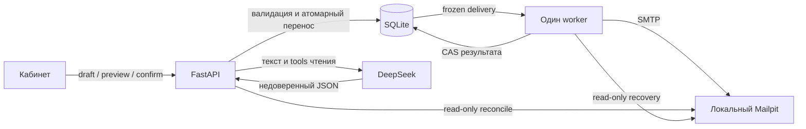

# Архитектурное ревью второго этапа

Исторический снимок проектного ревью до начала реализации; дальнейшее
исполнение и новые ревью фиксируются в [приёмке](../../acceptance.md).

26.10.2026. Объём: проект решения второго этапа, его контракты, срезы и
начальный TDD-набор. Продуктовый код ещё не реализован. Использован
`review-change`, авторская проверка и три независимых рецензента: доставка/
хранение; AI/API/UX; тестовая стратегия. Автор исправляет документы по
поручению пользователя; рецензенты не утверждают runtime-готовность.

## Итог архитектурного выбора

Сохраняются React/FastAPI/Pydantic, SQLite/sqlite3, один отдельный worker,
HTTPX, smtplib, DeepSeek и локальный Mailpit. Для одного организатора и
20 покупок ORM, брокер, lease-исполнитель и agent framework не нужны.
Основные риски находятся в контрактах переходов, а не в недостатке слоёв.
Реализация становится проверяемой через
[точный контракт и каталог T01–T30](../../notifications-contract.md) и
[подэтапы плана](../../work-plan.md).

DeepSeek не получает SQL/SMTP/confirm-инструментов. Пользовательский текст
пересекает внешнюю границу DeepSeek, список покупок/адресатов автоматически
не передаётся. Письма остаются в Mailpit. SQLite и его отдельная почтовая
БД не образуют общую транзакцию: неизвестный SMTP-результат требует сверки.

## Подтверждённые проблемы и внесённые решения

Все пункты ниже — P2 дефекты или пробелы исходной спецификации, не найденные
дефекты ещё отсутствующего приложения. Статус «исправлено» означает правку
проекта решения; выполнение будущего теста ещё требуется.

| ID  | Наблюдаемый сценарий / проблема                                                                                     | Сбалансированное решение                                                                                                               | Проверка                        |
| --- | ------------------------------------------------------------------------------------------------------------------- | -------------------------------------------------------------------------------------------------------------------------------------- | ------------------------------- |
| R01 | Человек проверил событие R1, событие стало R2 до первого preview; свежий snapshot скрывает старую проверку текста   | reviewed_event_revision передаётся клиентом, сверяется PATCH и preview; сервер не подставляет revision за пользователя                 | T09                             |
| R02 | Несохранённая дата B видна в форме, rewrite получает сохранённую A                                                  | Перед каждым AI-действием PATCH текущей формы, затем AI по возвращённой revision; save failure даёт 0 AI calls                         | T24,T26                         |
| R03 | Уход со страницы не отменяет серверный commit AI, хотя исходный текст обещал неприменение ответа                    | Разделено ожидание UI и сохранение backend; возврат читает GET, чужой экран не меняется                                                | T24,T26                         |
| R04 | ISO-валидный год может быть придуман моделью; Pydantic не знает, был ли год в запросе                               | Дата AI только suggested_start; proposed_start вводится организатором. Без NLP-парсера/второй LLM                                      | T23                             |
| R05 | Worker запущен до ручного resume: автоматический retry или pending отправятся раньше кнопки                         | В демо resume при остановленном worker, затем start; обычный automatic retry отдельно                                                  | T25                             |
| R06 | Pydantic EmailStr отвергает `a@example.test`; fixtures нельзя загрузить по предложенному правилу                    | `example.com` для синтетических адресов, штатную валидацию не ослаблять                                                                | T02; локальный эксперимент ниже |
| R07 | Таблица endpoint не определяет DTO/nullable/error envelope; два исполнителя могут реализовать несовместимые стороны | Один конкретный контракт; typed errors, состояния и порядок проверок; Pydantic затем становится executable owner                       | T03–T15                         |
| R08 | SQLite зависит от живого DeepSeek smoke; крупные 23/24 затрудняют локальный red→green                               | 21a/21b раздельно; 22 независим от внешних credentials; 23a–d и 24a–d с отдельными тестами                                             | Подэтапы плана                  |
| R09 | Старый перенос в retry, новый перенос отправлен; поздний retry старого вводит покупателя в заблуждение              | Запрет второго confirm того же события, пока есть pending/sending/retry_wait/unknown. Терминальные sent/failed разрешают новый перенос | T15                             |
| R10 | reset обещает остановленные процессы, но worker-lock не обнаруживает живой API                                      | Shared maintenance-lock API/worker и exclusive reset; файлы lock не удаляются                                                          | T01,T19                         |
| R11 | Требование tool-контекста для любого prepare блокировало корректное уточнение при event_id=null                     | Контекст обязателен для ненулевого ID; неоднозначность допускается после list_events, старый выбор сбрасывается                        | T23                             |

Дополнительно уточнены CAS сверки (sent нельзя понизить поздним отрицательным
readback), ошибка QUIT после принятого DATA, остановка worker при ошибке
записи результата, Host/Origin/redirect-граница локального сервиса, безопасные
логи и предел обещания не передавать email в LLM. Это конкретизация тестов
и остаточных рисков, без новой пользовательской инфраструктуры.

Выбор по R04 требует одного явного ввода даты даже при однозначном AI-ответе.
Альтернатива — parser/provenance для естественного языка — сложнее и оставляет
больше недетерминированных решений. По R09 неизвестная старая отправка может
блокировать следующий перенос: это честное ограничение вместо доставки
противоречивых уведомлений. Отмена/принудительная отправка по-прежнему вне scope.

## Матрица методов

S — selected, применён к спецификации/наблюдаемым артефактам; N — not-selected
по указанной причине. Это полный выбор методов, а не утверждение, что все
будущие runtime-проверки пройдены. Единицы: D — данные/доставка, A — AI/API/UI,
T — тесты/документы. Недоступных обязательных policy после разрешения symlink нет.

| Метод                      | D   | A   | T   | Основание / предел                                                                                       |
| -------------------------- | --- | --- | --- | -------------------------------------------------------------------------------------------------------- |
| code-quality               | N   | N   | S   | Код продукта отсутствует; существующий harness и новые тесты прочитаны/проверены                         |
| architecture               | S   | S   | S   | Владельцы состояния, imports, границы контрактов                                                         |
| comprehensive-architecture | S   | S   | S   | Явный запрос, UI/API/worker/DB/provider, межсрезовые риски                                               |
| flow                       | S   | S   | S   | Happy/failure/recovery, соответствие тестам                                                              |
| feasibility                | S   | S   | S   | Локальный EmailStr и существующий HTTP harness; реальные интеграции пока не исполнены                    |
| contract                   | S   | S   | S   | DTO, snapshot/revision, ошибки и тестовый seam                                                           |
| domain-logic               | S   | S   | S   | Получатели, перенос, подтверждение, лимиты                                                               |
| algorithm                  | S   | S   | S   | CAS/retry/reconcile, tool loop и завершение                                                              |
| security-threat-model      | S   | S   | S   | Локальные границы, недоверенный ввод, секреты, изоляция тестов                                           |
| privacy-data               | S   | S   | S   | Синтетические данные, текст в DeepSeek, logs/retention                                                   |
| failure-mode-fmea          | N   | N   | N   | Нет существующего изменяемого durable runtime; проектные отказы рассмотрены через flow/architecture ниже |
| operational-tabletop       | N   | N   | N   | Нет действующей операторской процедуры; будущие demo/reset описаны, не исполнялись                       |
| release-readiness          | N   | N   | N   | Нет поручения выпуска и реализованного этапа                                                             |
| test-strategy              | S   | S   | S   | Уровни проверки, meaningful red, promotion pending→основной suite                                        |
| documentation              | S   | S   | S   | Канонические владельцы, сохранение первого этапа                                                         |
| traceability               | S   | S   | S   | Каждый N-ID связан с T-ID и срезом                                                                       |
| performance-capacity       | S   | S   | N   | Последовательный worker, 20 покупок, ограниченный AI loop/deadline; нагрузочные выводы не делаются       |
| ux-cognitive-walkthrough   | S   | S   | N   | Действия восстановления/проверки, несохранённые поля, поздний ответ; отрендеренный UI отсутствует        |

## Инвентарь отказов и покрытия

| Поток             | Что рассмотрено                                                                    | Вердикт проекта решения                                                  |
| ----------------- | ---------------------------------------------------------------------------------- | ------------------------------------------------------------------------ |
| Подготовка/правка | Недоступный AI, invalid JSON/tool, stale draft, missing year, поздний ответ        | covered после R02–04; T23–24/26 ещё будущие                              |
| Получатели        | active/cancelled/дубли/другое событие/0                                            | covered, R06 исправлен; T02 будущий                                      |
| Preview/confirm   | Старый event/purchases, двойной confirm, rollback, время наступило, второй перенос | covered после R01/R07/R09; T08–15 будущие                                |
| SMTP              | 4xx/5xx/timeout, 250, ошибка QUIT, бюджет5, ошибка DB после отправки               | covered в правилах; T16–17 будущие                                       |
| Recovery          | Crash sending, exact readback, missing mail/API, конкурентная сверка               | covered; не обещает exactly-once; T19–21/29 будущие                      |
| Окружение         | Start/stop, reset vs active processes, retention, isolated Chaos                   | covered после R05/R10; T01/25/30 будущие                                 |
| Ранний TDD        | Реальный HTTP create/save/read, отсутствие импорта будущих модулей                 | исполняемый первоначальный red; последующие assertions ещё не достигнуты |
| N-01–16 целиком   | Каждое требование связано с тестовыми cases в каталоге и матрице плана             | покрыто планом; не runtime-приёмка                                       |

## Проверенные факты и пределы

- Локальный TypeAdapter(EmailStr) принимает `a@example.com` и отвергает
  `a@example.test` как special-use/reserved domain. Это фактическая проверка
  установленной зависимости, а не предположение о будущей конфигурации.
- Начальный pending-набор запускается на существующем FastAPI app; import/
  collection работают. 9 cases red, контрольный booking harness green.
  Red — отсутствующие HTTP-ответы/форма ошибки; сценарии conflict/restart
  пока останавливаются на create и ещё не подтверждают отдельные инварианты.
- Реальные Mailpit/DeepSeek, браузер кабинета и процессный recovery не
  запускались. Их отсутствие не скрывается зелёными тестами booking.
- Итоговые команды и результаты текущего изменения фиксируются в
  [приёмке](../../acceptance.md). Видео, push и публикация не выполнялись.

Повторное независимое ревью: R01/R05 и изменения delivery-контракта закрыты;
AI/API-рецензент подтвердил исправления R02/R03/R11 и самостоятельно запустил
pending-набор (9 red / 1 green). Новых подтверждённых P1/P2 в этих границах
не обнаружено. Авторский полный verify прошёл 256 существующих тестов;
отдельный pending typecheck green. Runtime второго этапа остаётся непроверенным.

Официальные основания точечных проверок протоколов:

[SMTP RFC 5321](https://www.rfc-editor.org/rfc/rfc5321),
[SQLite transactions](https://www.sqlite.org/lang_transaction.html),
[Mailpit Chaos](https://mailpit.axllent.org/docs/integration/chaos/).
