# UX/UI-аудит второй волны Sqoch

27.10.2026. Область: только кабинет организатора и уведомления о переносе.
Исследование и исправления — SQOCH-31, статус done. Независимый review-gate
PASS, открытых P0–P2 нет. Полный verify:508 green; результаты и пределы
зафиксированы в [приёмке](../../acceptance.md).

Отчёт сохраняет результаты SQOCH-31 до отклонения прежнего визуального
направления. Последующий выбор и реализация третьего минерального kit
описаны в [дизайн-системе](../../design-system.md) и [Design QA](../design/design-qa-sqoch-33-20261027.md).

## Метод и границы

Проведён экспертный когнитивный walkthrough работающего интерфейса и проверка
по [10 эвристикам Якоба Нильсена](https://www.nngroup.com/articles/ten-usability-heuristics/).
Для каждого сценария сопоставлены цель пользователя, видимое состояние,
следующее действие, отказ и восстановление. Проверялись иерархия, тексты,
клавиатурный фокус, адаптивность, названия действий и сохранность ввода.
Это экспертная оценка, а не интервью, исследование поведения участников
или измерение конверсии. Числовая «оценка UX из 10» не назначается.

Исходный интерфейс захвачен до изменений, затем повторно проверен после.
Все используемые ниже снимки получены в текущем проходе через in-app browser
и осмотрены. Исторические screenshots не используются как evidence этого аудита.
Для длинных экранов снималась нужная видимая область со скроллом; неудачный
full-page capture отклонён. Размеры проверены также автоматизированно на
360×800, 320×900, 768×1050 и 1440×1050.

Данные изолированы в отдельной SQLite аудита. DeepSeek prepare/rewrite
вызывались действительно. Шесть принятых писем проверены в настоящем локальном
Mailpit. Временный, окончательный и неопределённый исходы дополнительно
введены через транспортный double в production process_one — для управляемого
показа ошибок, без изменения правил worker. Это не выдаётся за настоящий
сетевой отказ SMTP. Внешних получателей и доставки нет.

Оформление билетов не входило в исследование и не редактировалось. Его
существующие автоматические проверки сохраняются как регрессионный gate.
В этом срезе визуальное направление не менялось: сохранялись Commissioner,
токены, размеры и композиция прежнего
[формуляра](../../design/archive/design-system-before-reset-20261027.md.txt).

## Что уже работало хорошо

- Отдельное подтверждение действительно предшествует изменению даты и отправке.
  В preview видны обе даты, письмо и полный серверный список адресов.
- Дата AI остаётся предложением: организатор явно вводит дату и время.
  Изменение формы снимает проверку текста; устаревший preview не подтверждается.
- Форма допускает ручное редактирование, а сохранённый draft восстанавливается.
  Ошибка помощника не уничтожает текст. Потеря ответа confirm не создаёт новую рассылку.
- У каждого адреса есть результат и попытки. Unknown не превращается в успех
  и не переотправляется вслепую. При потере сети последние counters сохраняются.
- Текст письма показывается буквально, включая похожие на HTML строки.
  Размеры текста и контролов не уменьшаются ради размещения.

## Найденные проблемы и исправления

P2 здесь означает наблюдаемое затруднение выполнения/восстановления, P3 —
менее критичное улучшение ориентации. Приоритет не является оценкой всех пользователей.

| ID    | Приоритет / эвристики | Наблюдение до                                                                                                                            | Решение и проверка                                                                                                                                                                                                     |
| ----- | --------------------- | ---------------------------------------------------------------------------------------------------------------------------------------- | ---------------------------------------------------------------------------------------------------------------------------------------------------------------------------------------------------------------------- |
| UX-01 | P2, H1/H6/H9          | После prepare сообщение о результате находилось примерно на y=1742 при viewport868, фокус терялся. Ошибка AI также уводила в конец формы | Ожидание, ответ и ошибка у своего действия; prepare ведёт к нужному полю, rewrite — к тексту. Проверены живые AI-действия, DOM-фокус и сохранность ввода                                                               |
| UX-02 | P2, H1/H7/H8          | Полное письмо отодвигало прогресс: y=1408 на360px. Recovery-кнопки шли после всех восьми результатов                                     | После события сразу прогресс и действия, затем результаты и неизменённое письмо. В проверенном mobile состоянии прогресс y=496, нижняя граница второй кнопки y=762 при800px                                            |
| UX-03 | P2, H4/H6             | Два draft одного события имели одинаковые название, статус и минуту создания; тему/новую дату можно было узнать только открыв каждый     | В списке тема, мероприятие, новая дата, статус и результат. CampaignSummary расширен двумя полями чтения, Pydantic/TS/guard обновлены вместе                                                                           |
| UX-04 | P2, H2/H9/H10         | «Проверить в Mailpit» выглядело как открытие почты, но запускало сверку. «Сверка завершена» не объясняла оставшийся unknown              | Разделены «Проверить результат отправки» и «Открыть письма в Mailpit». Ответ прямо называет неподтверждённые результаты, фокус остаётся у статуса. Полная справка объясняет повторы, лимит и отсутствие слепого resend |
| UX-05 | P3, H7/H10            | Форма начиналась с помощника без явного перехода к самостоятельному заполнению                                                           | Вступление объясняет два способа, «Заполнить вручную» ведёт к мероприятию без вызова AI. Пустое состояние поясняет первый шаг и границу отправки                                                                       |
| UX-06 | P2, H3/H5             | Перед confirm были названы перенос и отправка, но не невозможность редактирования/отмены этой рассылки                                   | У кнопки сохранено объяснение обоих эффектов, добавлены последствия и возможность вернуться к редактированию до подтверждения                                                                                          |
| UX-07 | P3, H1/H4/H6          | Вкладка кабинета называлась «билеты на мероприятие»                                                                                      | Title соответствует текущему экрану рассылки и возвращается при выходе из компонента                                                                                                                                   |
| UX-08 | P2, H3/H9             | Независимое ревью обнаружило побочный эффект колокации: AI-save conflict показывался сверху, а refresh оставался в footer                | Один контекстный alert/status содержит единственный refresh, его ожидание и результат. Отрицательный тест: PATCH409, AI не вызван, ввод сохранён, после refresh фокус на событии                                       |

Подробные тексты не удалены ради компактности. Для второстепенной справки
использован обычный раскрываемый details; полное письмо доступно и до, и
после подтверждения. Кнопки называются по результату действия, а ошибки
сохраняют объяснение и способ восстановления.

## Матрица всех десяти эвристик

| Эвристика                        | Рассмотренные сценарии                                    | Итог в этой границе                                                                                                     |
| -------------------------------- | --------------------------------------------------------- | ----------------------------------------------------------------------------------------------------------------------- |
| H1. Видимость состояния          | Загрузка, AI, сохранение, отправка, потеря сети           | Локальный feedback и progress перед письмом; неизвестность явно видна, polling не двигает фокус                         |
| H2. Понятный пользователю язык   | Даты, адресаты, Mailpit, повторы                          | Московское время явно названо; открытие почты и проверка результата различаются                                         |
| H3. Контроль и свобода           | Ручной ввод, правки, выход, конфликт, confirm             | Есть ручной путь и возврат из preview; правки сохраняются при обновлении. Ограничение отмены после confirm явно описано |
| H4. Согласованность              | Заголовки, формы, статусы, история                        | Сохранена дизайн-система; title, подписи действий и текущие docs согласованы                                            |
| H5. Предотвращение ошибок        | Неполная/прошедшая дата, checkbox, stale preview, confirm | Прежние ограничения сохранены, последствия confirm объяснены; нет отправки от команды помощнику                         |
| H6. Узнавание вместо запоминания | История, AI-результат, обе даты, preview email            | Рассылки различимы без открытия, нужный контекст остаётся на экране                                                     |
| H7. Гибкость и эффективность     | AI/ручной путь, rewrite, recovery                         | Не требуется пользоваться AI; заметные действия восстановления не скрыты под письмом/списком                            |
| H8. Иерархия и уместность        | Длинное письмо, справка, mobile                           | Главное состояние впереди, второстепенная справка раскрывается; содержание не обедняется                                |
| H9. Диагностика и восстановление | AI failure,409, offline, retry, unknown, failed           | Ошибка рядом с recovery; неудачная сверка не выдаётся за успех; данные сохраняются                                      |
| H10. Помощь в контексте          | Пустое состояние, запрос/правка, правила отправки         | Названы ожидаемый ввод, следующий шаг, граница действия и правила повторов                                              |

## Восемь проверенных пользовательских сценариев

### 1. Найти или создать рассылку — улучшен

Пустое состояние предлагает понятный первый шаг. Два подготовленных draft
одного события были неразличимы, теперь видны разные темы/даты. Повторная
загрузка восстанавливает список сохранённых записей.

| До                                                                                   | После                                                                               |
| ------------------------------------------------------------------------------------ | ----------------------------------------------------------------------------------- |
| 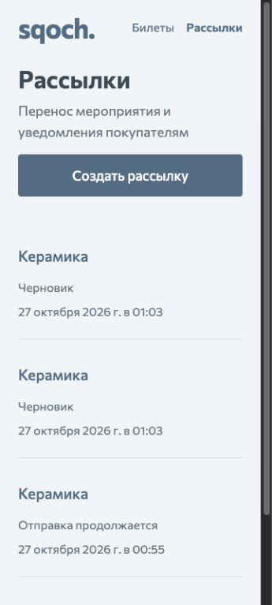 | 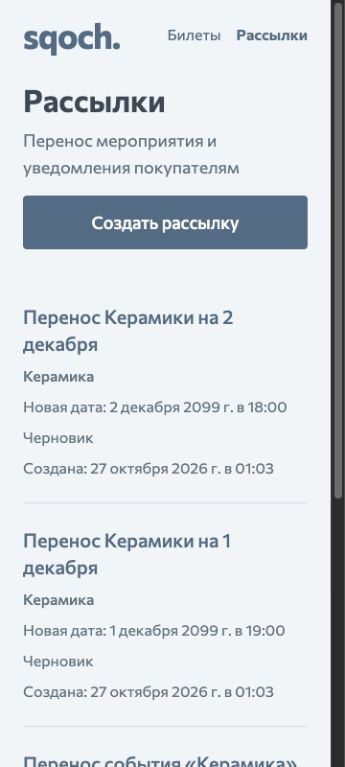 |

### 2. Подготовить письмо с AI или вручную — улучшен

Ручной переход не отправляет HTTP mutation. Живой prepare заполнил текст и
событие; дата осталась пустой до явного ввода. После ответа фокус находится
на дате, feedback виден рядом с помощником. Во время ожидания поля заблокированы.

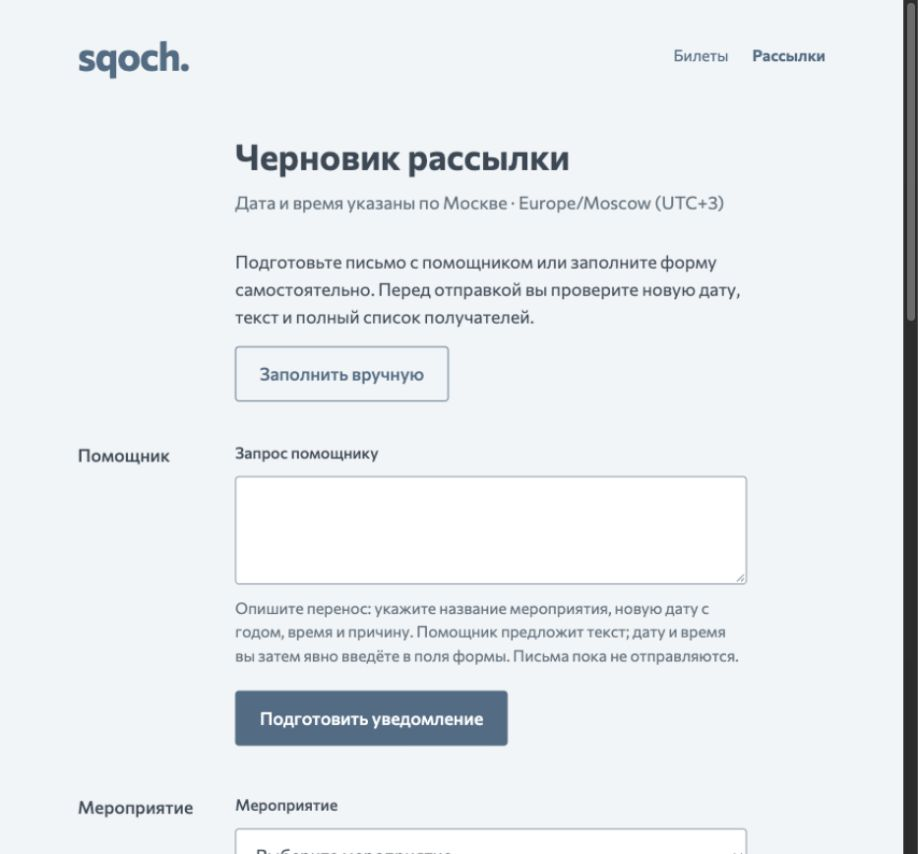

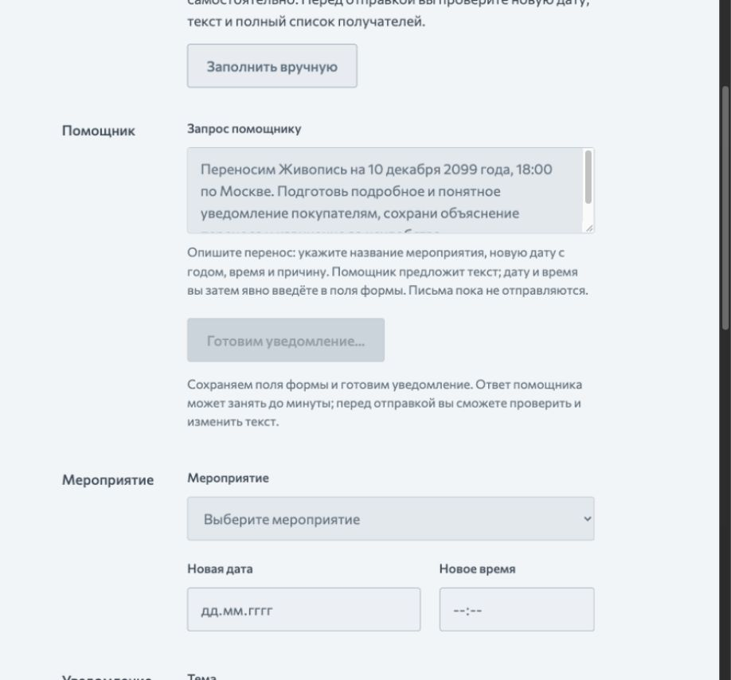

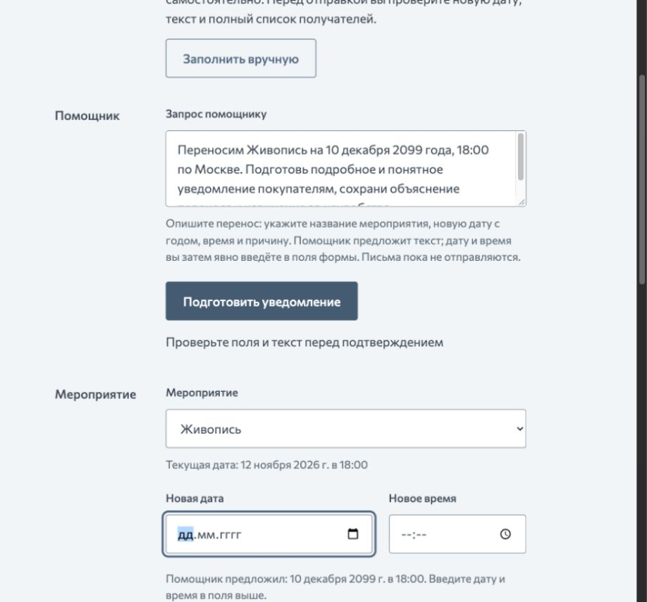

### 3. Отредактировать подробное письмо — проверен и улучшен

Живой rewrite сохранил введённые 10.12.2099/18:00, изменил только тему/текст
и вернул фокус к письму. В проверенном результате477символов; краткость не
навязывалась. Команда и исходные поля не уничтожаются при ошибке.

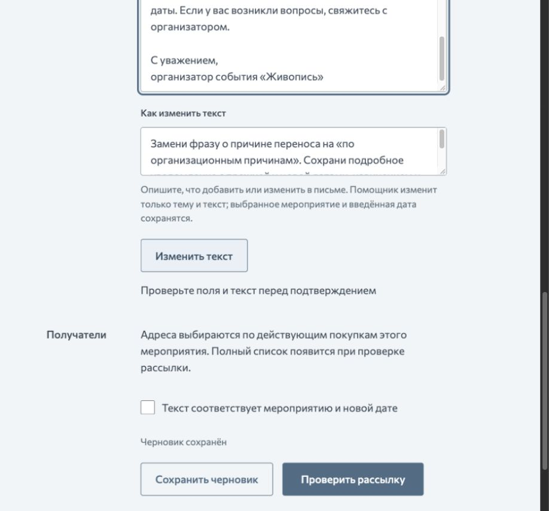

### 4. Проверить состав и подтвердить — улучшен

В preview сохранены полный текст, обе даты и все5 email для «Живописи»
(ранее проверены8 для «Керамики»). До подтверждения доступно редактирование;
последствия названы непосредственно перед действием. Этот preview не отправлялся.

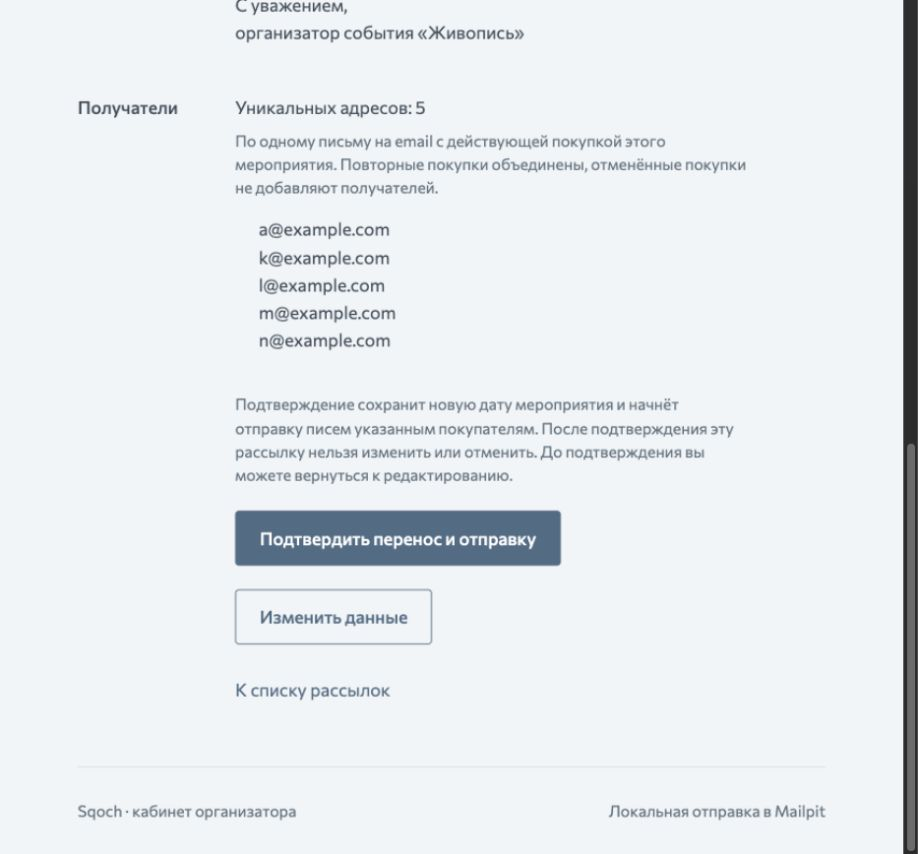

### 5. Наблюдать отправку — улучшен

На360×800 counters и обе recovery-кнопки видны без чтения всего письма.
Письмо остаётся полным ниже результатов; это не изменение согласованного текста.

| До                                                                                             | После                                                                                      |
| ---------------------------------------------------------------------------------------------- | ------------------------------------------------------------------------------------------ |
| 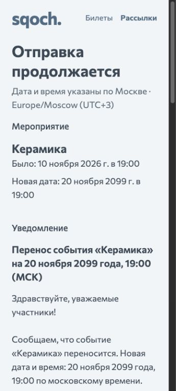 | 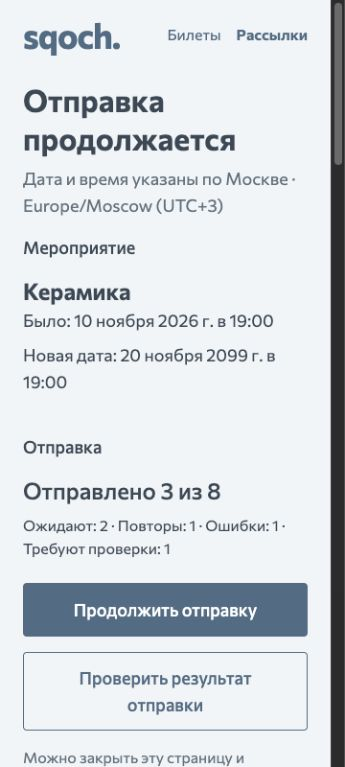 |

### 6. Продолжить после временного отказа — проверен

Через UI выполнен resume; production worker принял ещё три письма. В итоге6
sent,1 failed,1 unknown. Прежние sent не отправлялись повторно; шесть настоящих
писем имеют точные Mailpit matches без дублей. UI показывает частичный результат,
не полный успех. Причины ошибок доступны у адресов.

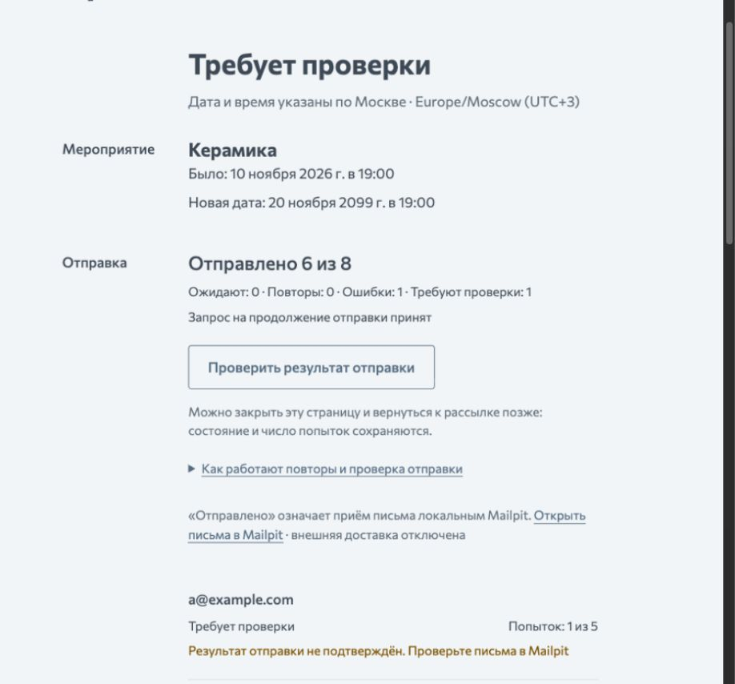

### 7. Разобраться с unknown — улучшен

Сверка не нашла подтверждения для одного управляемого unknown. Статус остался
неопределённым, отправка не повторилась, ответ объяснил результат. Фокус
поставлен на общую обратную связь; справка доступна с клавиатуры.

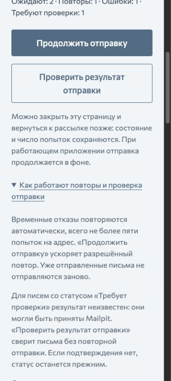

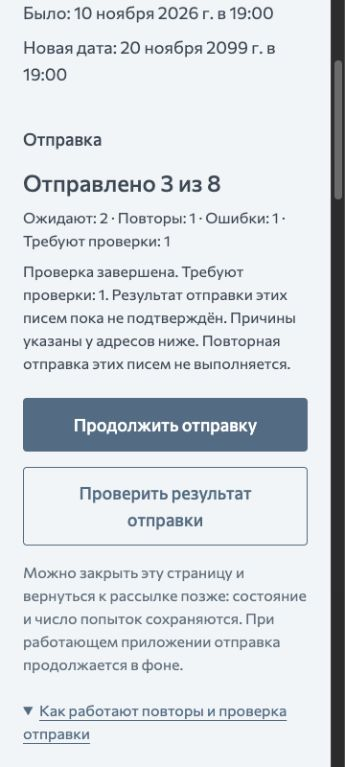

### 8. Вернуться после сетевого сбоя — проверен

Остановка собственного audit backend воспроизвела потерю соединения.
Прогресс сохранил последние данные и пометил их; список показал ошибку и retry.
После перезапуска «Повторить загрузку» вернул сохранённые записи и фокус на заголовок.

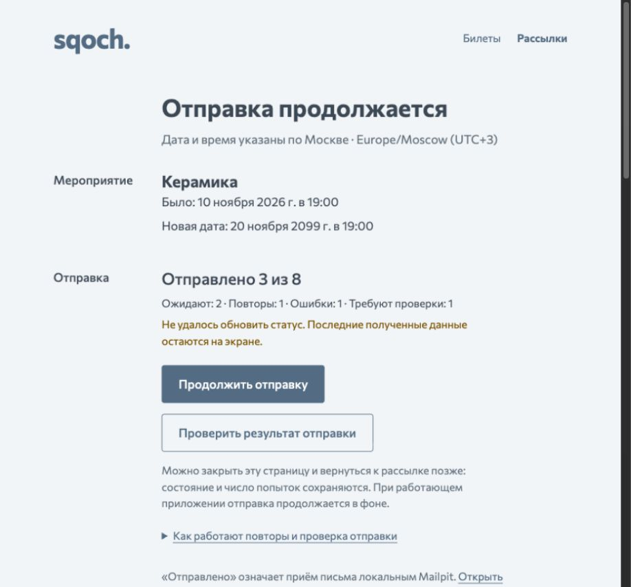

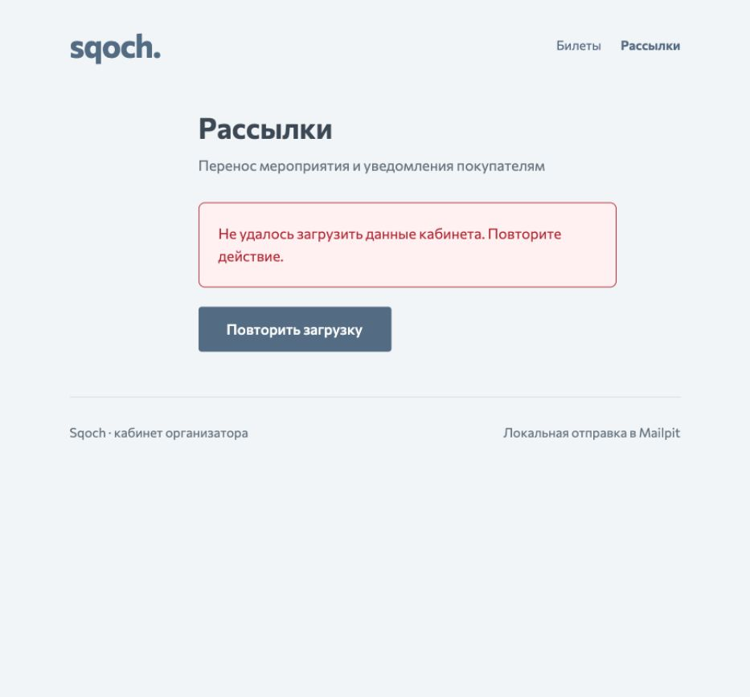

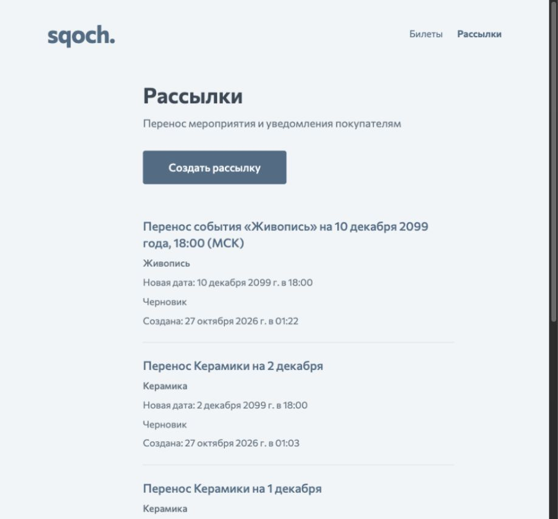

## Проверки изменения

Первоначальные11 целевых UI/transport cases учитываются по циклам:10 получили
содержательный red до основной реализации; ещё один red воспроизвёл найденный
reviewer конфликт. Все11 затем green. Три настоящих HTTP/SQLite tests сначала
падали на отсутствующих subject/proposed_start в summary, затем green.
Browser assertion восстановления сначала получил1226px вместо допустимых800;
после изменения иерархии/details те же проверки green на обоих проектах.

Текущие владельцы проверок:

- `src/features/organizer/heuristics.test.tsx` — история, ручной переход,
  AI feedback/focus/error/conflict, сохранность, порядок, результат сверки,
  последствия confirm, title, повреждённый DTO;
- `backend/tests/test_campaign_flow.py` — summary пустого/draft/confirmed,
  прежние atomicity/snapshot/concurrency проверки;
- `e2e/organizer.spec.ts` — настоящий UI/API/SQLite/worker с сетевыми doubles
  в основных flow; отдельные controlled HTTP cases — длинные/HTML значения,
  доступность ссылок и положение recovery-controls;
- `contracts:check` — Pydantic и общий TypeScript-контракт синхронны.

Независимый reviewer выявил UX-08; после авторского исправления повторил44
organizer frontend и32 campaign-flow backend tests, проверил контракт,
осмотрел after и подтвердил закрытие замечания.
Runtime verdict PASS, открытых P0–P2 нет. Полный `pnpm verify` exit0:
123 frontend +291 backend +28 tooling +66 E2E =508. Типы, линтеры, формат,
контракт, сборка и ссылки15 Markdown также green. Browser suite включает
14 organizer cases и прежние52 booking cases; booking остаётся регрессией,
не частью данного исследования. Clean-copy запуск не повторялся: доказательство
этого среза — текущая рабочая копия и изолированная E2E SQLite.

## Существенные пределы и принятые ограничения

Реальные интервью, screen-reader/device session, аналитика конверсии и A/B
эксперименты не выполнялись. По screenshots не заявляется полное WCAG-соответствие.
Автоматические guards, keyboard/DOM и viewport checks дополняют визуальный осмотр.
Принятые границы сохранены: локальный один организатор, без авторизации,
внешней доставки и публичного развёртывания; подтверждённая рассылка неизменна,
unknown не переотправляется вслепую. Новые функции отмены, ручного изменения
получателей или мониторинга worker не добавлялись. Работа в фоне предполагает
работающее приложение. Видеозапись по-прежнему отложена до отдельного указания.
