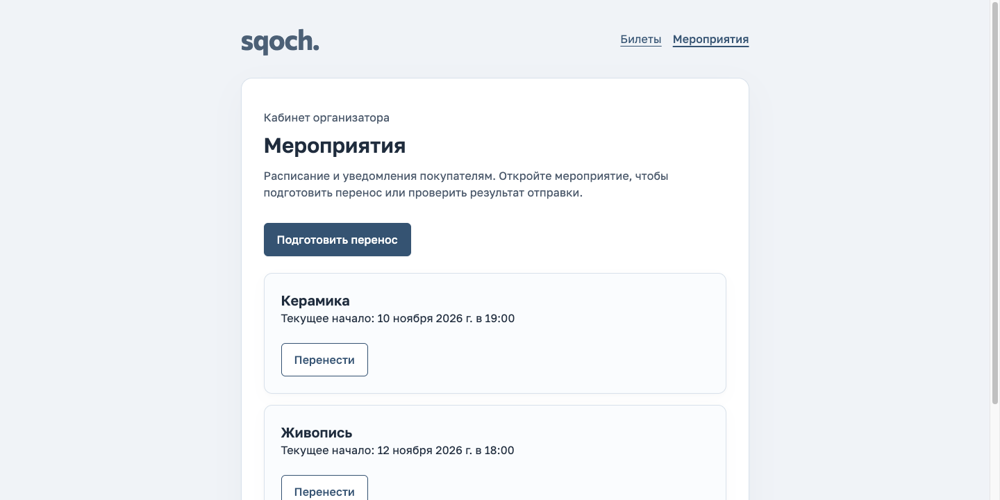
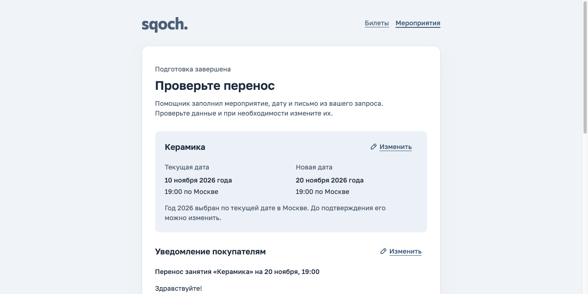
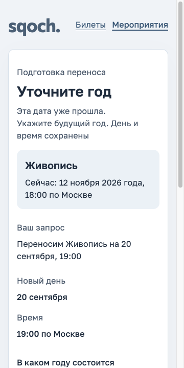
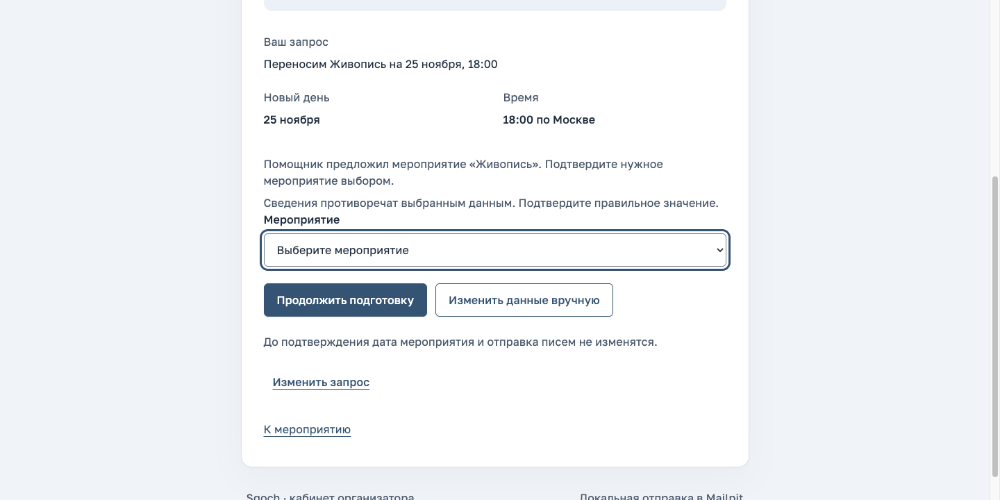
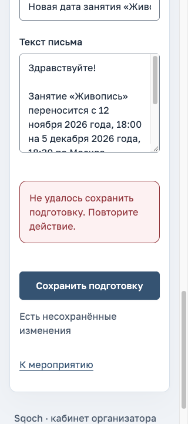
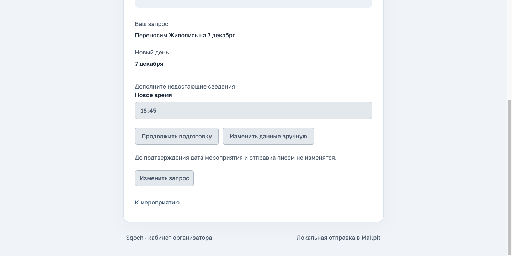
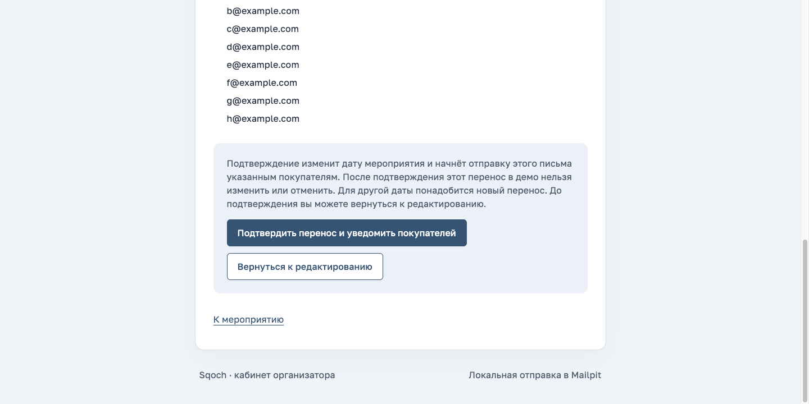
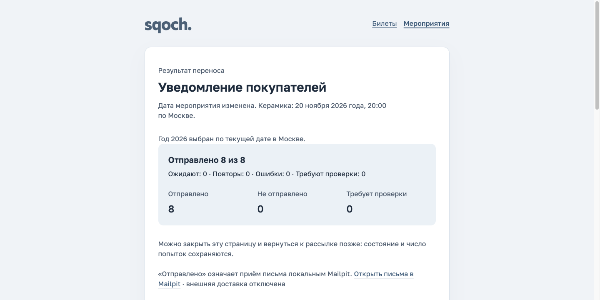
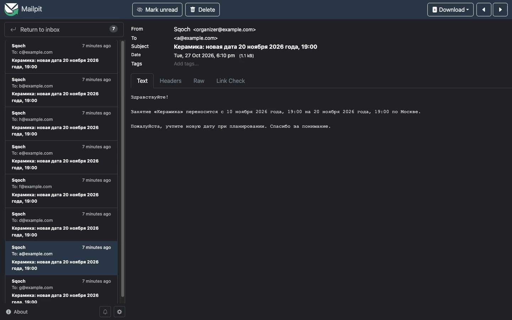

# Перенос мероприятия: браузерная приёмка 27.10.2026

Проверка выполнена после явного сброса тестовых данных по запросу пользователя.
Основной путь пройден в браузере с настоящими DeepSeek и локальным Mailpit;
найденные проблемы исправлены через TDD и новое независимое ревью.
Используются принятый минеральный kit, Golos Text, Phosphor Bold и прежний логотип.

[Сводные проверяемые метаданные](../quality/event-transfer-browser-verification-20261027.json)
· [Предметные мутации](../quality/event-transfer-browser-mutations-20261027.json)
· [Итоговое видео](../demo/event-transfer.mp4).

## Подготовка и границы данных

Перед первым сбросом остановлены проектные API/worker и созданы согласованная
SQLite-копия `before-reset.sqlite3` и выгрузка 22 прежних писем в
`mailpit-before/`. Перед чистым демонстрационным проходом сохранены
`before-video.sqlite3` с шестью проверочными подготовками и восемь писем
в `mailpit-before-video/`. Копии и отчёты сбросов находятся в
`.cache/event-transfer-browser-20261027/`. Это согласованный сброс синтетических
данных; прежнее требование сохранять их без изменений заменено этим запросом.
Исходный код, чужой накопленный diff и исторические артефакты не сбрасывались.

Чистая фикстура содержит два мероприятия и 20 отдельных тестовых покупок.
Первый этап оформления билетов эти покупки не создаёт. Получатели переноса
«Керамики»: восемь уникальных активных email; повторная покупка не добавляет
письмо, отменённые покупки не входят в выборку. SMTP направлен только в
локальный Mailpit на 1025/8025; внешняя доставка отключена.

## Пройденные шаги

| Шаг | Проверка и состояние                                                                                                                                                                                  | Итог                      |
| --- | ----------------------------------------------------------------------------------------------------------------------------------------------------------------------------------------------------- | ------------------------- |
| 1   | Чистый обзор, мероприятие и общая навигация. Посещение страницы и переключение режима не создают пустых подготовок.                                                                                   | Пройден                   |
| 2   | Пустой запрос показывает адресную ошибку. Достаточный запрос без года получает текущий московский год, подготовленные дату и письмо; человеческая отметка остаётся выключенной.                       | Пройден                   |
| 3   | Прошедшая дата спрашивает только год. Проверены ошибка ответа, ответ 2027, reload и предупреждение об уходе с несохранённым вводом.                                                                   | Пройден                   |
| 4   | Общий помощник выбирает «Живопись», уточняет только время; ответ 18:30 сохраняет дату. Противоречие с контекстом «Керамики» требует явного принятия другого мероприятия.                              | Пройден                   |
| 5   | Ручной режим раскрывается под запросом. На 320 px проверены валидация, ошибка сети, сохранность полей, повтор и восстановление. Ручное сохранение не вызывает LLM.                                    | Пройден                   |
| 6   | Ручная смена времени и rewrite используют актуальные факты. Во время продолжения уточнения ответ 18:45 остаётся видимым, нового вопроса о годе нет; подготовка и rewrite имеют видимый статус работы. | Пройден после исправлений |
| 7   | Без человеческой отметки preview не открывается. Отдельный серверный preview показывает точные даты, письмо и всех получателей. Только отдельное подтверждение меняет событие и создаёт deliveries.   | Пройден                   |
| 8   | Отправка достигает 8/8, reload сохраняет результат, возврат открывает правильное мероприятие и историю. Адресаты, тема, тело и единственный Message-ID каждого письма сверены с Mailpit.              | Пройден                   |

Снимки ниже показывают реальные состояния браузерного прохода. Это отдельный
проверочный прогон, а не кадры финального видео. Названия событий и даты
соответствуют состоянию каждого шага; промежуточные подготовки после проверки
сохранены в backup и удалены согласованным чистым сбросом перед записью.

### 1. Обзор и мероприятие

[Детали мероприятия](../preview/event-transfer-browser-20261027/02-event-details.png).

### 2. Автоматически подготовленный перенос

[Ошибка пустого запроса](../preview/event-transfer-browser-20261027/03-empty-request-error.png)
· [Обязательная человеческая проверка](../preview/event-transfer-browser-20261027/05-human-review-required.png).

### 3. Адресное уточнение года

[Ошибка ответа](../preview/event-transfer-browser-20261027/07-year-validation-mobile.png)
· [Сохранённый результат ответа 2027](../preview/event-transfer-browser-20261027/08-year-answer-prepared-mobile.png).

### 4. Выбор события и времени

[Общий помощник и вопрос времени](../preview/event-transfer-browser-20261027/09-no-context-missing-time-mobile.png)
· [Время уточнено](../preview/event-transfer-browser-20261027/10-missing-time-resolved-mobile.png)
· [Другое мероприятие принято явно](../preview/event-transfer-browser-20261027/12-conflict-accepted.png).

### 5. Ручной ввод и ошибка сети

[Валидация](../preview/event-transfer-browser-20261027/13-manual-validation-320.png)
· [Восстановление](../preview/event-transfer-browser-20261027/15-manual-restored-320.png).

### 6. Уточнение во время ожидания ответа

[Rewrite после исправления приоритета фактов](../preview/event-transfer-browser-20261027/16-rewrite-fixed.png).

### 7. Отдельное подтверждение

### 8. Результат и история

[История на desktop](../preview/event-transfer-browser-20261027/20-event-history-desktop.png)
· [История на mobile](../preview/event-transfer-browser-20261027/21-event-history-mobile.png).

Отдельный кадр финального видео после чистого сброса:

[История из финального MP4](../preview/event-transfer-browser-20261027/video/13-event-history.jpg).

## Найденные и исправленные проблемы

- **R1: rewrite использовал прежние факты запроса.** После ручной правки времени
  модель могла сохранить старое время в письме. Подтверждённые структурированные
  факты текущей подготовки теперь имеют явный приоритет в запросе rewrite.
  Отдельный семантический сканер не добавлялся; текст по-прежнему проверяет человек.
- **R2: во время подготовки появлялся лишний вопрос.** Обычный промежуточный
  PATCH заново вычислял общие вопросы и мог вставить год вместо адресного
  уточнения времени или события. Теперь он сохраняет точные вопросы, причины
  и кандидата. Клиент сохраняет локальный ответ и dirty-защиту до доказанного
  сохранения. Общий статус AI виден и при свёрнутом редакторе письма.
- **R3: чужой readback мог быть принят за собственный результат.** Совпадения
  запроса и общей revision недостаточно. Восстановление ответа уточнения
  проверяет intake revision и все отправленные ответы. Чужая новая версия
  сохраняет местный ввод и включает существующее явное обновление сведений.
- **README описывал прежний сценарий.** Инструкция обновлена под мероприятия,
  текущий год, фактические действия интерфейса, 11 organizer E2E и 42 мутации.

Все исправления прошли содержательный RED → green и независимое ревью.
Отдельно повторены девять проверок rewrite, 50 draft cases и десять целевых
frontend cases. Подтверждённых открытых P0–P2 в проверенной дельте не осталось.

## Автоматические и реальные проверки

Финальный `pnpm verify` завершился с exit 0: **897 тестов**, из них
346 frontend, 432 backend, 45 tooling и 74 desktop/mobile E2E. Типы, lint,
форматирование, OpenAPI, build и документационные ссылки прошли.
Итоговый предметный мутационный набор: **42 killed**, survived/invalid/timeout 0.
Это конечные смысловые мутации, а не глобальная оценка всего AST.

В проверочном браузерном прогоне «Керамика» перенесена с 10 ноября 2026 года,
19:00 на 20 ноября 2026 года, 20:00. Получены восемь реальных SMTP-писем;
To, тема и substantive plain-text body совпали, каждый Message-ID найден
ровно один раз, у каждой доставки одна попытка. RFC-переносы строк и конечный
newline нормализованы при сравнении. «Живопись» осталась на прежней дате.
Readback сохранён в `.cache/event-transfer-browser-20261027/audit-delivery.json`.

После нового чистого сброса для видео выполнен отдельный перенос «Керамики»
с 10 ноября 2026 года, 19:00 на 20 ноября 2026 года, 19:00. Итоговая campaign:
`737e443d-036b-46a8-9064-4b698e84d64f`. В ней восемь доставок sent с одной
попыткой; все восемь писем повторно сверены по To/subject/body и единственному
Message-ID. В финальной рабочей БД остаются два события, 20 покупок и одна
демонстрационная campaign. [Сводный пакет](../quality/event-transfer-browser-verification-20261027.json)
разделяет проверочный и демонстрационный прогоны.

## Видео и пределы доказательства

[Итоговая демонстрация](../demo/event-transfer.mp4) записана после исправлений
по отдельному указанию пользователя. Это смонтированная демонстрация реального
браузерного сценария; длительное бездействие сокращено, использованные кадры
сохраняют фактический порядок. Финальные сцены результата, Mailpit и истории
сняты отдельными сегментами. Состояния приложения не подменялись.
Это не непрерывная запись разработки и не доказательство времени отклика.
Техническая и визуальная приёмка MP4 завершены: 87,933333 с, 1440×900,
H.264/yuv420p, 30 fps, без звука, faststart. Полное декодирование прошло,
14 кадров, извлечённых из итогового файла, и обзор сцен осмотрены; Mailpit
не содержит артефакта повторного sidebar из отклонённых IAB-снимков.
Все 115 исходных кадров сохранены без изменения, порядок захвата соблюдён.
[Медиа-метаданные, SHA-256 и ограничения монтажа](../quality/event-transfer-video-20261027.json)
· [Сценарий ролика](../demo/README.md#демонстрация-переноса-мероприятия-от-27102026).

В папке снимков 23 попытки захвата. Кадры `22-mailpit-eight.png` и
`23-mailpit-message.png` исключены из визуальных свидетельств: в IAB обнаружен
повтор части изображения за границей реально отрисованной поверхности.
Это дефект захвата, а не Mailpit или приложения. Письма подтверждены DOM
и точной сверкой raw EML; Mailpit также показан реальными кадрами финального видео.
Остальные снимки используются только для показанного состояния и viewport,
а не для заявления о пиксельном совпадении всех страниц.

Свежий ручной проход выполнен на desktop и узких ширинах 360/320 px.
Клавиатура, reflow, forced colors, reduced motion, stale preview, потеря ответа
confirm и unknown/reconcile дополнены исполняемыми тестами. Скриншоты сами
по себе не подтверждают соответствие WCAG, screen reader или все устройства.
Управляемые E2E-отказы не выдаются за новый реальный SMTP crash/451-прогон.
Настоящий провайдер проверен на выполненных запросах, а не на всех будущих
формулировках. Push, публикация и внешняя доставка не выполнялись.
